# ChantierFlow — Architecture technique & modèle de données

| | |
|---|---|
| **Version** | 1.0 — 5 novembre 2026 |
| **Auteur** | Mamadou BA |
| **Statut** | Proposition pour le MVP (à relire avant le sprint « Jours 16–30 ») |
| **Sources** | Cahier des charges ChantierFlow v1.0 · Maquettes « ChantierFlow — Écrans MVP » (Figma) · Décisions de modélisation validées |
| **Cible** | Backend Go + PostgreSQL 16, PWA Next.js, hébergement mono-région |

> **Objectif de ce document** : définir un backend **performant dès le MVP et capable de tenir la charge sur plusieurs années**, sans payer dès aujourd'hui la complexité d'une architecture distribuée. Chaque choix est accompagné de sa justification, de ses compromis et de son déclencheur de révision.

---

## Sommaire

1. [Décisions structurantes (résumé des ADR)](#1-décisions-structurantes-résumé-des-adr)
2. [Hypothèses de charge et exigences non fonctionnelles](#2-hypothèses-de-charge-et-exigences-non-fonctionnelles)
3. [Architecture logique](#3-architecture-logique)
4. [Backend : monolithe modulaire en Go](#4-backend--monolithe-modulaire-en-go)
5. [Frontend PWA et mode hors ligne](#5-frontend-pwa-et-mode-hors-ligne)
6. [Sécurité, multi-tenant et permissions](#6-sécurité-multi-tenant-et-permissions)
7. [Modèle de données](#7-modèle-de-données)
8. [Règles financières et machines à états](#8-règles-financières-et-machines-à-états)
9. [Schéma PostgreSQL complet (DDL)](#9-schéma-postgresql-complet-ddl)
10. [Accès aux données : sqlc, transactions et requêtes](#10-accès-aux-données--sqlc-transactions-et-requêtes)
11. [API REST](#11-api-rest)
12. [Traitements asynchrones](#12-traitements-asynchrones)
13. [Infrastructure, déploiement et exploitation](#13-infrastructure-déploiement-et-exploitation)
14. [Trajectoire de scalabilité](#14-trajectoire-de-scalabilité)
15. [Stratégie de tests](#15-stratégie-de-tests)
16. [Risques et décisions encore ouvertes](#16-risques-et-décisions-encore-ouvertes)

---

## 1. Décisions structurantes (résumé des ADR)

### 1.1 Règles métier validées pour le modèle de données

| Règle | Décision | Conséquence dans le modèle |
|---|---|---|
| **Budgets** | **Versionnés** | `budget_versions` + `budget_lines`. Une version approuvée est **immuable** (trigger SQL). Toute révision crée la version N+1 avec motif obligatoire. Une seule version « en vigueur » par chantier (index unique partiel). |
| **Dépenses** | **Workflow d'approbation** | Machine à états `draft → submitted → approved / rejected`, `cancelled`. Seuil d'auto-approbation configurable. Paiement suivi sur un **axe séparé** (`payment_status`) avec paiements partiels (`expense_payments`). |
| **Stock** | **Par chantier** | Journal append-only `material_movements` ; stock théorique projeté dans `project_material_stock` par (chantier, article). Transferts inter-chantiers via `stock_transfers` (en transit → reçu). |
| **Utilisateurs** | **Une seule entreprise par utilisateur** | Pas de table `memberships` : `users.organization_id` + `users.role`. Email et téléphone uniques sur toute la plateforme. Accès aux chantiers via `project_members`. |

### 1.2 Décisions d'architecture

| # | Sujet | Choix | Alternatives écartées | Pourquoi |
|---|---|---|---|---|
| ADR-01 | Style d'architecture | **Monolithe modulaire**, un seul binaire (modes `api` et `worker`) | Microservices, Kubernetes dès le départ | Transactions ACID entre dépenses, agrégats et audit ; un seul déploiement ; coût d'exploitation minimal. Les frontières de modules permettent d'extraire un service plus tard. |
| ADR-02 | Langage backend | **Go** (1.23+) | NestJS + Prisma (proposé dans le cahier) | Le choix de **sqlc** impose Go. Binaire statique de ~20 Mo, ~30–60 Mo de RAM, démarrage instantané : idéal pour un petit VPS. Concurrence native pour les uploads et exports. Contrepartie : deux langages (Go/TS), compensée par un contrat OpenAPI qui génère le client TypeScript. |
| ADR-03 | Accès aux données | **sqlc + pgx/v5**, SQL écrit à la main | ORM (GORM, Prisma) | Le SQL est explicite et revu en code review : indispensable pour les règles financières, la RLS et les index. sqlc génère du code typé, vérifié à la compilation contre le schéma. Pas de requêtes N+1 cachées. |
| ADR-04 | Base de données | **PostgreSQL 16** unique | MySQL, NoSQL | Transactions, contraintes CHECK, index partiels, RLS, partitionnement, `pg_trgm` pour la recherche : tout le besoin MVP + 3 ans tient dans PostgreSQL. |
| ADR-05 | Multi-tenant | **Schéma partagé** + `organization_id` partout + **clés étrangères composites** + **RLS** | Schéma par tenant, base par tenant | Un seul schéma à migrer ; coût par client quasi nul. Trois barrières indépendantes contre la fuite inter-entreprises (cf. §6). |
| ADR-06 | Identifiants | **UUIDv7** générés par l'application **et par le client PWA** | `BIGSERIAL`, UUIDv4 | Création hors ligne sans aller-retour serveur et idempotence naturelle (renvoi = même id). UUIDv7 est ordonné dans le temps : insertions B-tree localisées, contrairement à UUIDv4. |
| ADR-07 | Montants | `BIGINT` en unité mineure (XOF = 0 décimale) | `NUMERIC`, `float` | Arithmétique exacte et rapide ; aucune erreur d'arrondi. Une devise par entreprise au MVP. |
| ADR-08 | Énumérations | `TEXT` + `CHECK` | Types `ENUM` PostgreSQL | Ajouter/retirer une valeur = simple migration de contrainte, sans les limites de `ALTER TYPE`. Les constantes typées sont définies côté Go. |
| ADR-09 | Agrégats financiers | **Table d'agrégats maintenue dans la même transaction** + réconciliation nocturne | Vues matérialisées, calcul à la volée | Dashboard en O(nombre de catégories) quel que soit le volume de dépenses ; toujours exact (pas de rafraîchissement différé). Le job nocturne recalcule depuis les sources et alerte en cas d'écart. |
| ADR-10 | Jobs asynchrones | **River** (file de jobs Go stockée dans PostgreSQL) | BullMQ/Redis, RabbitMQ | Insertion du job **dans la même transaction** que l'écriture métier (pas d'outbox à coder, pas de job perdu). Aucun composant d'infra supplémentaire au MVP. |
| ADR-11 | Authentification | **Sessions opaques** en cookie `HttpOnly`, mots de passe **argon2id**, implémentées dans le module `identity` | Keycloak, Auth0, JWT longue durée | Besoins simples (email/téléphone + mot de passe, invitations, OTP SMS plus tard). Révocation immédiate (« Déconnecter les autres sessions » des maquettes). Pas de dépendance à un IdP externe. |
| ADR-12 | Fichiers | **Object storage S3-compatible**, upload direct par **URL pré-signée** | Stockage disque local, transit par l'API | L'API ne transporte jamais les octets des photos : elle reste légère. Bucket privé, liens de lecture de courte durée. |
| ADR-13 | Contrat d'API | **OpenAPI 3.1 spec-first** (`oapi-codegen` côté Go, `openapi-typescript` côté front) | GraphQL, tRPC | Un contrat unique, versionné sous `/api/v1`, qui génère les types des deux côtés. |
| ADR-14 | Frontend | **Next.js + TypeScript + Tailwind + shadcn/ui**, PWA avec Service Worker et IndexedDB | Applications natives | Pas de publication sur les stores pour valider le produit ; une seule base de code mobile/desktop. |
| ADR-15 | Hébergement | **Conteneurs Docker sur VPS** (Caddy + API + worker), PostgreSQL dédié avec sauvegardes WAL | Kubernetes, PaaS propriétaire | Portable (cloud local sénégalais ou européen), peu coûteux, simple à opérer. Kubernetes reste une étape possible (phase 3), pas un prérequis. |

---

## 2. Hypothèses de charge et exigences non fonctionnelles

### 2.1 Volumétrie estimée

Hypothèses (à recaler après les pilotes) : une PME type = 6 chantiers actifs, 8 utilisateurs, ~20 dépenses/jour, 1 rapport/chantier/jour, ~25 photos/jour.

| Indicateur | Pilote (3 entreprises) | An 1 (100 entreprises) | An 3 (1 000 entreprises) |
|---|---|---|---|
| Utilisateurs | ~25 | ~800 | ~8 000 |
| Dépenses / an | ~20 k | ~600 k | ~6 M |
| Rapports journaliers / an | ~6 k | ~180 k | ~1,8 M |
| Photos & reçus / an | ~25 k | ~900 k | ~9 M |
| Volume base de données | < 1 Go | ~5 Go | ~40 Go |
| Volume object storage (photos ~300 Ko) | ~8 Go | ~270 Go | ~2,7 To |
| Pic de requêtes API | < 5 req/s | ~30 req/s | ~300 req/s |

**Enseignement clé** : la base de données restera modeste ; c'est **le stockage des photos** qui grossit le plus vite. D'où la compression côté client, les règles de conservation (`attachments.delete_after`) et le choix d'un object storage sans frais de sortie élevés.

### 2.2 Exigences non fonctionnelles retenues

| Domaine | Cible | Comment elle est tenue |
|---|---|---|
| Latence | P95 < 700 ms (cahier) ; **objectif interne P95 < 200 ms** sur les lectures usuelles | Agrégats pré-calculés, index composites préfixés par `organization_id`, pagination par curseur, pool pgx. |
| Disponibilité | 99,5 % mensuel | Déploiement sans coupure (blue/green derrière Caddy), healthchecks, restauration testée. |
| Données | RPO ≤ 5 min, RTO ≤ 2 h | Archivage WAL continu + sauvegarde complète quotidienne chiffrée, hors site. |
| Réseau terrain | Saisie possible sans réseau | Brouillons et file d'envoi locale, photos compressées (< 400 Ko). |
| Sécurité | Zéro fuite inter-entreprises | FK composites + RLS + contrôle applicatif + tests d'isolation en CI. |
| Compatibilité | Chrome Android, Safari iOS, navigateurs desktop récents | PWA, budget JS initial < 200 Ko gzip. |

---

## 3. Architecture logique

### 3.1 Vue d'ensemble (conteneurs)

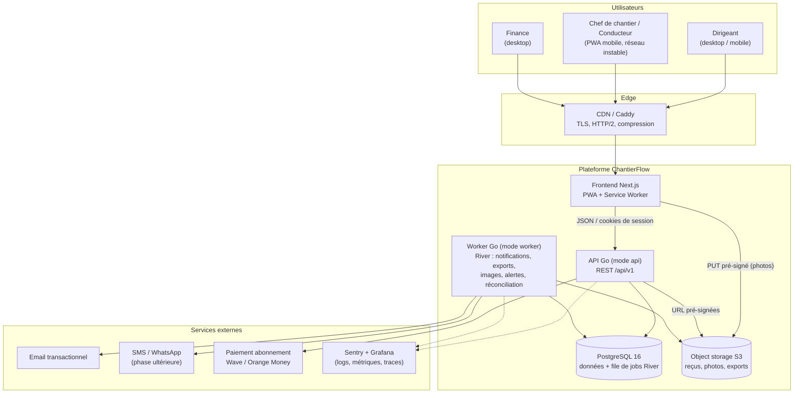

### 3.2 Principes

- **Un seul binaire Go**, deux modes de lancement : `chantierflow api` et `chantierflow worker`. Même code, même version, déployés ensemble.
- **PostgreSQL est la seule source de vérité** : données métier, agrégats, file de jobs, idempotence. Pas de Redis au MVP.
- **Les octets ne passent pas par l'API** : le navigateur envoie les photos directement à l'object storage via une URL pré-signée ; l'API ne gère que les métadonnées.
- **Le frontend est un client comme un autre** de l'API publique documentée (OpenAPI), ce qui prépare une future application native ou un portail client.

---

## 4. Backend : monolithe modulaire en Go

### 4.1 Modules et responsabilités

| Module | Responsabilité | Tables principales |
|---|---|---|
| `identity` | Inscription, connexion, sessions, invitations, réinitialisation, verrouillage après 5 échecs | `users`, `sessions`, `invitations`, `password_reset_tokens` |
| `organization` | Profil entreprise, paramètres, catégories, membres et rôles | `organizations`, `organization_settings`, `expense_categories` |
| `project` | Chantiers, équipe du chantier, avancement déclaré, archivage | `projects`, `project_members` |
| `budget` | Versions de budget, lignes, approbation, historique | `budget_versions`, `budget_lines` |
| `expense` | Dépenses, workflow, doublons, paiements, engagements | `expenses`, `expense_payments`, `expense_status_history`, `commitments` |
| `finance` | Agrégats, KPI, alertes de seuil, réconciliation | `project_category_financials`, `project_alert_state` |
| `fieldops` | Rapports journaliers, tâches | `daily_reports`, `daily_report_tasks`, `tasks` |
| `inventory` | Articles, mouvements, transferts, stock théorique | `materials`, `material_movements`, `stock_transfers`, `project_material_stock` |
| `supplier` | Fiches fournisseurs, recherche | `suppliers` |
| `files` | URL pré-signées, validation, galerie, conservation | `attachments` |
| `reporting` | Exports CSV/XLSX/PDF, export complet ZIP | `exports` |
| `notification` | In-app, email, Web Push ; préférences ; anti-spam | `notifications`, `notification_preferences`, `push_subscriptions` |
| `sync` | Idempotence, détection et résolution des conflits offline | `idempotency_keys`, `sync_conflicts` |
| `audit` | Journal immuable des actions sensibles | `audit_events` |
| `billing` | Offres, limites (chantiers actifs), abonnements, factures | `plans`, `subscriptions`, `billing_invoices` |

**Règles de dépendance** : un module n'accède qu'à **ses** tables. Pour lire les données d'un autre module, il passe par l'interface Go publique de ce module (ex. `project.Service.CanAccess`). Les seules exceptions assumées sont `finance` (qui reçoit des « deltas » des modules `expense` et `budget` dans la même transaction) et `audit` (appelé par tous). Ces règles sont vérifiées en CI avec un linter d'imports (`depguard` / `go-arch-lint`).

### 4.2 Organisation du dépôt

```text
chantierflow/
├── cmd/chantierflow/main.go          # sous-commandes : api | worker | migrate
├── api/openapi.yaml                  # contrat d'API (source de vérité)
├── db/
│   ├── migrations/                   # goose : 0001_init.sql, 0002_...sql (up/down)
│   ├── queries/                      # fichiers .sql annotés pour sqlc, un par module
│   └── sqlc.yaml
├── internal/
│   ├── platform/                     # config, logger slog, pgx pool, tx manager, s3, mail, otel
│   ├── httpx/                        # routeur chi, middlewares (session, tenant, rate limit, idempotence)
│   ├── identity/   organization/  project/  budget/  expense/  finance/
│   ├── fieldops/   inventory/     supplier/ files/   reporting/
│   ├── notification/  sync/  audit/  billing/
│   └── jobs/                         # définitions des workers River
├── web/                              # application Next.js (PWA)
├── deploy/                           # docker-compose, Caddyfile, scripts de sauvegarde
└── .github/workflows/                # CI/CD
```

Chaque module suit la même structure : `handler.go` (HTTP ↔ DTO), `service.go` (règles métier, transactions), `store.go` (wrapper autour du code généré par sqlc), `service_test.go`.

### 4.3 Pipeline d'une requête

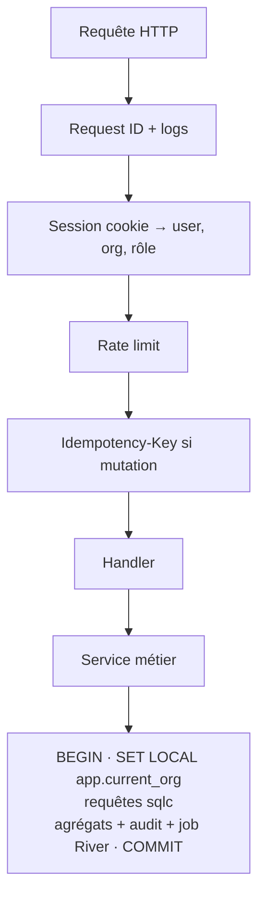

Le middleware tenant ne fait confiance **qu'à la session** pour déterminer l'organisation (jamais à un paramètre d'URL ou du corps de la requête).

### 4.4 Bibliothèques retenues

| Besoin | Choix |
|---|---|
| Routeur HTTP | `go-chi/chi` (compatible `net/http`) |
| Driver PostgreSQL | `jackc/pgx/v5` (+ `pgxpool`) |
| Génération SQL typée | `sqlc` |
| Migrations | `pressly/goose` (SQL pur, lu aussi par sqlc) |
| Jobs | `riverqueue/river` |
| Validation | `go-playground/validator` + validation du schéma OpenAPI |
| Mots de passe | `golang.org/x/crypto/argon2` (argon2id) |
| UUIDv7 | `google/uuid` (`uuid.NewV7`) |
| PDF / XLSX | `go-pdf/fpdf` (ou rendu HTML → PDF via Gotenberg en phase 2), `xuri/excelize` |
| Images | `disintegration/imaging` (miniatures dans le worker) |
| Observabilité | `log/slog` (JSON), OpenTelemetry, `getsentry/sentry-go` |

---

## 5. Frontend PWA et mode hors ligne

### 5.1 Stack

- **Next.js (App Router) + TypeScript**, Tailwind, shadcn/ui (direction visuelle « modern » des maquettes).
- **TanStack Query** pour le cache serveur ; **Dexie** (IndexedDB) pour le stockage local ; **Serwist** (Workbox) pour le Service Worker.
- Client d'API **généré depuis `openapi.yaml`**.
- Compression des photos dans le navigateur avant envoi (cible ≤ 400 Ko, 1600 px de côté max, EXIF de localisation retiré).
- Interface en français, i18n prête (`next-intl`) ; formats `fr-SN`, devise XOF sans décimale.

### 5.2 Périmètre du hors ligne (volontairement limité)

| Disponible hors ligne | Réservé au mode connecté |
|---|---|
| Créer / modifier un **brouillon** de dépense, de rapport journalier, de mouvement de stock | Approuver / rejeter une dépense |
| Prendre des photos (stockées localement en attendant) | Réviser un budget |
| Consulter les derniers chantiers, catégories, fournisseurs et articles mis en cache | Gérer les membres, l'abonnement, les exports |
| Soumettre (mise en file : la soumission part au retour du réseau) | Transférer du stock entre chantiers |

### 5.3 Protocole de synchronisation

1. Chaque création reçoit un **UUIDv7 généré sur le téléphone** et un horodatage local (`client_created_at`).
2. Chaque mutation est placée dans une **file d'envoi** (outbox IndexedDB) avec un en-tête `Idempotency-Key`.
3. Au retour du réseau, la file est rejouée **dans l'ordre** : d'abord les métadonnées, puis l'upload des photos (URL pré-signée), puis la confirmation de la pièce jointe.
4. Le serveur répond de façon **idempotente** : un renvoi avec la même clé retourne la réponse mémorisée (`idempotency_keys`) ; une création avec un id existant ne crée pas de doublon (`ON CONFLICT (id) DO NOTHING`).
5. Les modifications portent le `row_version` vu par le client. S'il a changé côté serveur, l'API répond **409** et enregistre un `sync_conflicts` avec les deux versions : **rien n'est écrasé silencieusement**, l'utilisateur choisit.
6. États affichés : *brouillon local · en attente d'envoi · synchronisé · échec (réessayer)* (conformes aux maquettes).

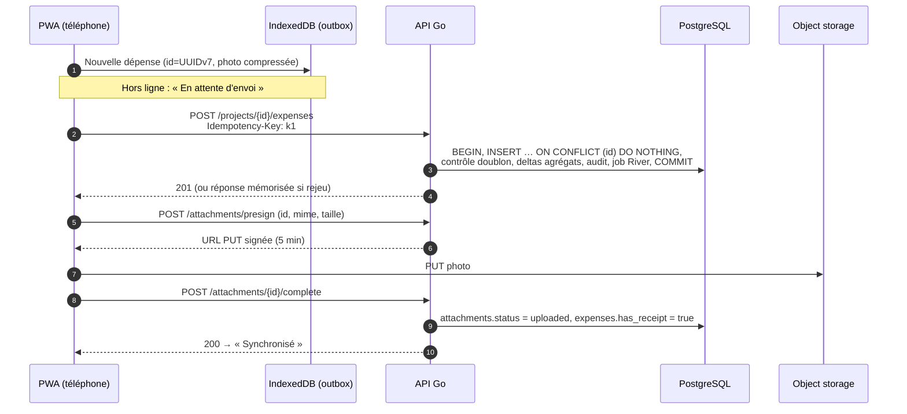

---

## 6. Sécurité, multi-tenant et permissions

### 6.1 Isolation des entreprises : trois barrières indépendantes

| Barrière | Mécanisme | Ce qu'elle empêche |
|---|---|---|
| 1. Application | Le tenant vient **uniquement de la session** ; chaque requête sqlc filtre par `organization_id` ; contrôle d'accès au chantier (`CanAccessProject`). | Les erreurs de logique courantes. |
| 2. Intégrité référentielle | **Clés étrangères composites** `(organization_id, x_id) → x(organization_id, id)`. | Qu'une dépense de l'entreprise A référence un chantier, une catégorie ou un fournisseur de l'entreprise B — même avec un bug. |
| 3. Row Level Security | Politique `organization_id = current_org()` sur toutes les tables, `FORCE ROW LEVEL SECURITY`, rôle applicatif sans `BYPASSRLS`. `current_org()` vaut NULL si non positionné → **aucune ligne visible** (fail closed). | Toute requête oubliant le filtre, y compris dans un futur module. |

Ces trois barrières ont été vérifiées sur PostgreSQL 16 : un utilisateur positionné sur une autre entreprise voit 0 chantier, une insertion pour une autre entreprise est refusée par la RLS, et sans contexte tenant aucune ligne n'est visible.

**Login** : avant authentification, l'organisation n'est pas connue. La recherche de l'utilisateur passe par la fonction `auth_find_user()` (`SECURITY DEFINER`, propriété d'un rôle dédié `cf_auth`) : c'est le **seul** chemin qui lit `users` hors tenant.

### 6.2 Rôles et permissions (issus des maquettes « Équipe et permissions »)

| Action | Owner / Admin | Finance | Conducteur | Chef de chantier | Lecture seule |
|---|---|---|---|---|---|
| Voir les chantiers | Tous | Tous | Assignés | Assignés | Partagés |
| Créer une dépense / un rapport / un mouvement de stock | Oui | Non | Oui | Oui | Non |
| Approuver / rejeter une dépense | Oui | Oui | Si délégué (`project_members.can_approve`, plafond `approval_limit`) | Non | Non |
| Enregistrer un paiement | Oui | Oui | Non | Non | Non |
| Créer / réviser un budget | Oui | Non | Non | Non | Non |
| Exporter les données financières | Oui | Oui | Non | Non | Non |
| Gérer membres, paramètres, abonnement | Oui | Non | Non | Non | Non |

> Les maquettes ont été conçues autour de **trois profils principaux** (Dirigeant, Conducteur/Chef de chantier, Finance) ; le modèle en distingue cinq pour couvrir la délégation et la lecture seule sans effort supplémentaire.

Règle supplémentaire : **personne n'approuve sa propre dépense** (contrôle applicatif + test). La matrice est codée dans un seul fichier Go (`internal/organization/permissions.go`) et testée exhaustivement (table de vérité rôle × action).

### 6.3 Authentification et sessions

- Mots de passe **argon2id** (≥ 10 caractères dont un chiffre, comme dans la maquette d'inscription).
- Jeton de session aléatoire de 256 bits, stocké **haché (SHA-256)** dans `sessions` ; cookie `HttpOnly; Secure; SameSite=Lax` ; durée glissante 30 jours (« Rester connecté »), 12 h sinon.
- **Verrouillage 15 minutes après 5 échecs** (`failed_login_count`, `locked_until`) + limitation de débit par IP.
- Invitations : lien à **usage unique, valable 7 jours, révocable**, envoyé par email ou SMS ; jeton haché en base.
- Phase 2 : OTP SMS à la connexion depuis un nouvel appareil (`mfa_enabled`).
- Protection CSRF : `SameSite` + en-tête `X-CSRF-Token` sur les mutations ; CSP stricte côté Next.js.

### 6.4 Fichiers

- Bucket **privé** ; clé objet `org/{org_id}/proj/{project_id}/{yyyy}/{mm}/{attachment_id}.{ext}`.
- URL pré-signées : **PUT 5 min**, **GET 10 min**, émises seulement après contrôle d'accès au chantier.
- Types autorisés (JPEG, PNG, WebP, PDF, CSV, XLSX, ZIP) et taille ≤ 25 Mo contrôlés **deux fois** : à la demande d'URL et dans le job de post-traitement (lecture des octets réels, recalcul du SHA-256).
- Conservation : `delete_after` calculé à l'archivage du chantier selon `receipt_retention_days` ; purge par job.

### 6.5 Audit

`audit_events` enregistre qui, quand, quoi (avant/après en JSON) pour : approbations/rejets, paiements, révisions de budget, exports, changements de rôle ou de membres, archivage, paramètres. Table **partitionnée par mois** et **append-only** (trigger qui refuse UPDATE/DELETE). Les journaux ne contiennent jamais de mot de passe, jeton ni contenu de document.

### 6.6 Données personnelles (Sénégal)

Le service traite des données de collaborateurs, de clients et de fournisseurs. Avant commercialisation : vérifier les obligations de la **loi n° 2008-12** et les formalités auprès de la **CDP**, en particulier si l'hébergement est hors du Sénégal (cf. §13.5). L'export complet ZIP et la clôture de compte (prévus dans les Paramètres des maquettes) couvrent la portabilité et la suppression. *Ce document n'est pas un avis juridique.*

---

## 7. Modèle de données

### 7.1 Conventions

| Convention | Règle |
|---|---|
| Clés primaires | `UUID` (v7 générés par l'application ou le client) ; `BIGINT IDENTITY` pour les historiques purement internes |
| Tenant | `organization_id NOT NULL` sur **toutes** les tables métier, même quand la relation est indirecte |
| Intégrité inter-tables | FK composites `(organization_id, …)` + contrainte `UNIQUE (organization_id, id)` sur chaque table parente |
| Montants | `BIGINT` (FCFA entiers) ; jamais de `float` |
| Quantités | `NUMERIC(14,3)` |
| Temps | `TIMESTAMPTZ` en UTC ; dates métier (`expense_date`, `report_date`) en `DATE` ; affichage dans le fuseau de l'entreprise (`Africa/Dakar`) |
| Concurrence | Colonne `row_version` sur les entités éditables (verrou optimiste, conflits offline) |
| Suppression | **Pas de suppression physique** des données financières : annulation + audit. Archivage des chantiers. |
| Index | Toujours préfixés par `organization_id` ; index partiels pour les files de travail (`WHERE status = 'submitted'`) |
| Recherche | `pg_trgm` (GIN) sur noms de chantiers, fournisseurs et descriptions de dépenses |

### 7.2 Vue d'ensemble des domaines

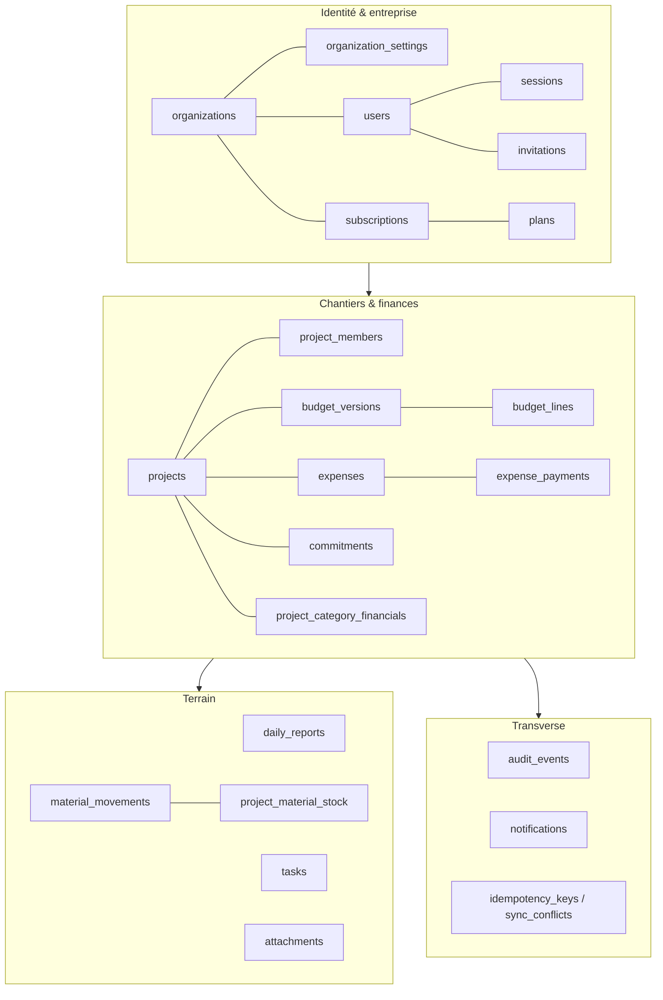

### 7.3 ERD — Identité, organisation, abonnement

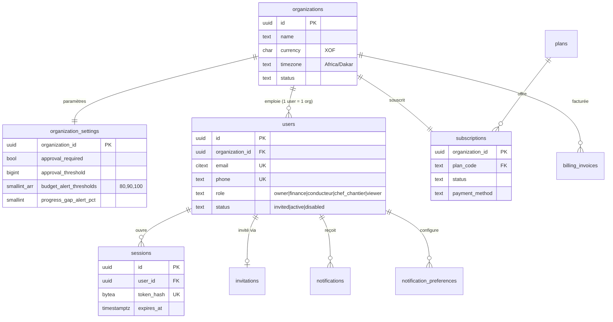

### 7.4 ERD — Chantiers, budgets, dépenses, engagements

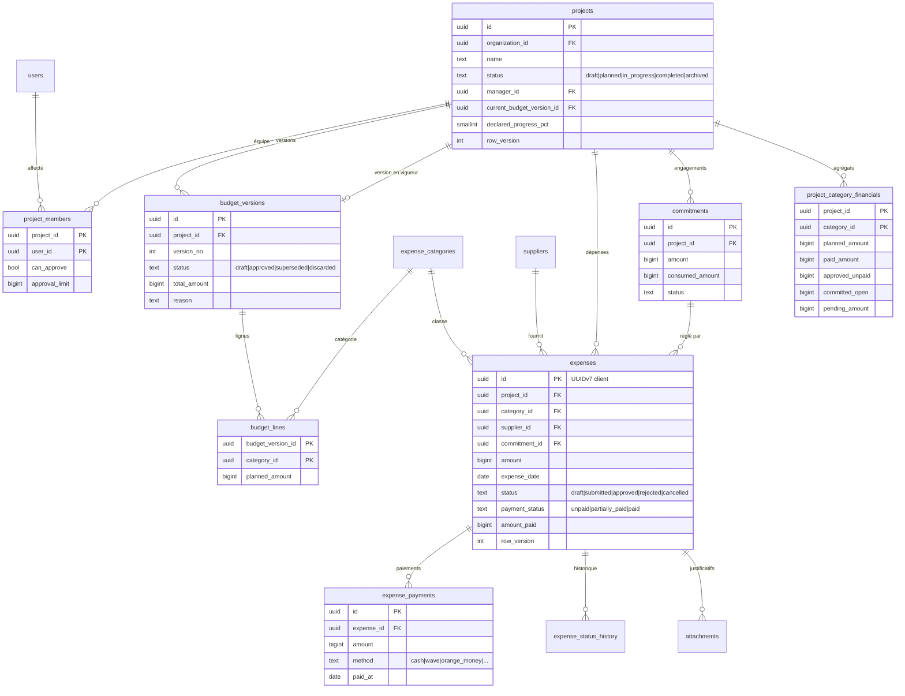

### 7.5 ERD — Terrain : rapports, tâches, stock, fichiers

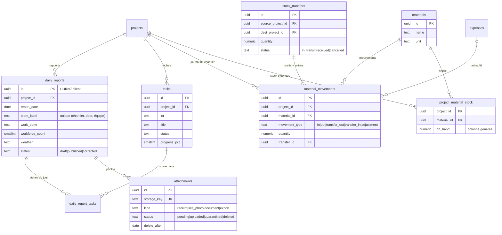

### 7.6 Dictionnaire des tables

| Table | Rôle | Points d'attention |
|---|---|---|
| `organizations` | Racine du tenant | Devise et fuseau par entreprise ; statut `closing` pendant l'export de clôture. |
| `organization_settings` | Règles paramétrables (seuil de validation, alertes 80/90/100 %, écart budget/avancement, doublons, rappel de rapport) | Une ligne par entreprise ; dérogation par chantier via `projects.approval_threshold_override`. |
| `users` | Utilisateur rattaché à **une** entreprise, avec son rôle | Email/téléphone uniques globalement ; désactivation sans suppression (historique conservé). |
| `sessions`, `invitations`, `password_reset_tokens` | Authentification | Jetons stockés hachés uniquement. |
| `plans`, `subscriptions`, `billing_invoices` | Offres Starter/Business/Pro, abonnement, factures | Limite « chantiers actifs » contrôlée à la création/activation d'un chantier. |
| `projects` | Chantier | `current_budget_version_id` pointe la version en vigueur ; `row_version` pour les éditions concurrentes. |
| `project_members` | Qui voit quel chantier | Délégation d'approbation + plafond. |
| `expense_categories` | Catégories par entreprise | `system_code` garde des catégories comparables entre entreprises (rapports, benchmarks futurs). |
| `budget_versions`, `budget_lines` | Budget versionné | Immuable après approbation (trigger) ; motif obligatoire dès la v2. |
| `commitments` | Commandes engagées non payées | `consumed_amount` évite le double comptage avec les dépenses qui les règlent. |
| `expenses` | Dépense | Id client ; deux axes (validation, paiement) ; drapeau doublon ; source online/offline. |
| `expense_payments` | Paiements (partiels) | Méthodes locales : espèces, Wave, Orange Money, Free Money, virement, chèque. Annulation logique. |
| `expense_status_history` | Historique du workflow | Alimente l'onglet « Historique » du chantier. |
| `project_category_financials` | Agrégats (prévu, payé, engagé, en attente) | Mis à jour transactionnellement ; vue `project_financial_summary` pour le niveau chantier. |
| `project_alert_state` | Mémoire des alertes envoyées | 1 notification par seuil et par version de budget (anti-spam). |
| `daily_reports`, `daily_report_tasks` | Rapport journalier | Unicité (chantier, date, équipe) ; republication = statut `corrected`. |
| `tasks` | Tâches / lots | Pondération pour calculer un avancement global (V1.3). |
| `materials` | Catalogue d'articles de l'entreprise | Unicité (nom, unité). |
| `material_movements` | Journal de stock **append-only** | Correction = mouvement inverse (`reverses_id`) ou ajustement motivé. |
| `stock_transfers` | Transfert entre chantiers | Crée `transfer_out` à l'envoi, `transfer_in` à la réception. |
| `project_material_stock` | Stock théorique par (chantier, article) | Maintenu par trigger : toujours égal à la somme du journal. |
| `attachments` | Métadonnées des fichiers | Au plus un propriétaire métier ; statut d'upload ; conservation. |
| `exports` | Demandes d'export | Générées par le worker ; lien expirant. |
| `notifications`, `notification_preferences`, `push_subscriptions` | Notifications | `dedup_key` unique pour éviter les doublons. |
| `idempotency_keys`, `sync_conflicts` | Synchronisation offline | Purge des clés > 7 jours. |
| `audit_events` | Journal d'audit | Partitionné par mois, append-only. |

---

## 8. Règles financières et machines à états

### 8.1 Indicateurs (définitions du cahier, traduites en SQL)

| Indicateur | Formule |
|---|---|
| Budget révisé | Σ `planned_amount` de la version **approuvée** en vigueur |
| Dépenses payées | Σ `amount_paid` des dépenses `approved` |
| Dépenses en attente | Σ `amount` des dépenses `submitted` (n'entrent **pas** dans l'exposition) |
| Engagements ouverts | Σ (`amount − consumed_amount`) des engagements ouverts **+** Σ (`amount − amount_paid`) des dépenses approuvées non soldées |
| Exposition totale | Dépenses payées + engagements ouverts |
| Disponible prévisionnel | Budget révisé − exposition totale |
| Écart budget / avancement | `exposure_pct − declared_progress_pct` ; alerte si > `progress_gap_alert_pct` (signal à examiner, jamais une conclusion de fraude) |

**Pas de double comptage avec les engagements** : quand une dépense liée à un engagement est approuvée, `commitments.consumed_amount` augmente du même montant ; l'exposition passe de « engagement ouvert » à « dépense approuvée » sans être comptée deux fois.

### 8.2 Machine à états des dépenses

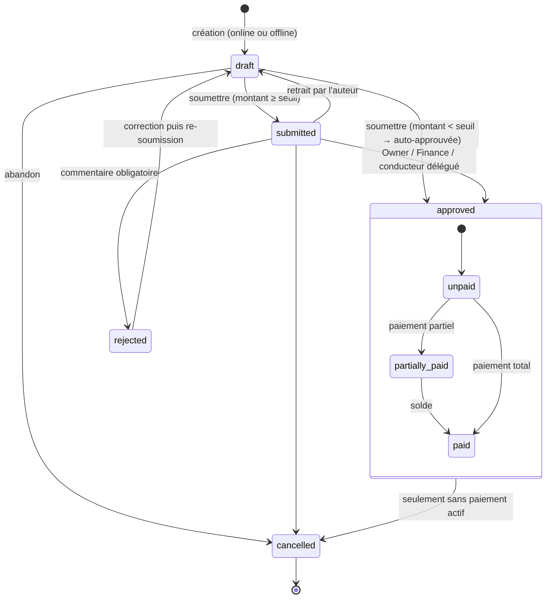

Les transitions sont implémentées dans le service Go **et** protégées par un trigger SQL (`check_expense_transition`) : une transition illégale échoue même si elle venait d'un script ou d'un bug. Une dépense décidée (approuvée/rejetée) ne peut plus changer de montant.

### 8.3 Effets de chaque événement sur les agrégats

Toutes ces mises à jour se font dans **la même transaction** que le changement de statut (`ApplyFinancialDelta`).

| Événement | `pending_amount` | `paid_amount` | `approved_unpaid` | `committed_open` |
|---|---|---|---|---|
| Soumission (`draft → submitted`) | + montant | | | |
| Retrait / rejet / annulation d'une dépense soumise | − montant | | | |
| Approbation (`submitted → approved`) | − montant | + déjà payé | + (montant − déjà payé) | − part consommée de l'engagement lié |
| Auto-approbation (`draft → approved`) | | + déjà payé | + (montant − déjà payé) | − part consommée de l'engagement lié |
| Paiement sur dépense approuvée | | + paiement | − paiement | |
| Paiement sur dépense non approuvée | *aucun effet (pris en compte à l'approbation)* | | | |
| Annulation d'une dépense approuvée sans paiement | | | − montant | + part rendue à l'engagement |
| Création / annulation d'un engagement | | | | ± montant restant |
| Approbation d'une nouvelle version de budget | `planned_amount` remplacé par les lignes de la nouvelle version (`ResetPlannedAmounts`) | | | |

Le job nocturne `RecomputeProjectFinancials` recalcule chaque colonne depuis les tables sources et lève une alerte Sentry en cas d'écart : les agrégats sont une **optimisation vérifiée**, jamais une source de vérité.

### 8.4 Cycle de vie d'un budget

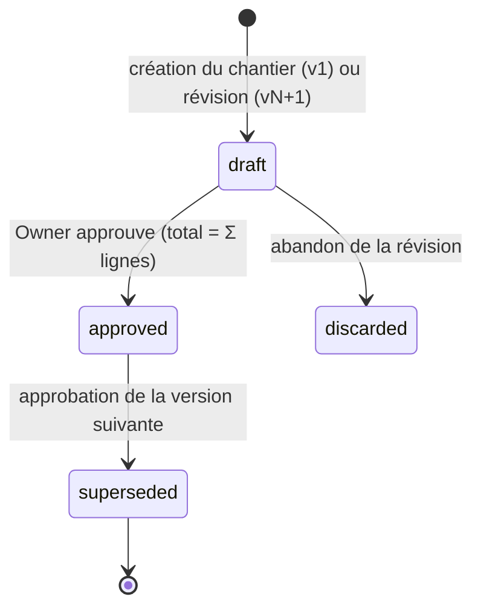

Approbation d'une révision, en une transaction : `SupersedeCurrentBudget` → `ApproveBudgetVersion` → `SetProjectCurrentBudget` → `ResetPlannedAmounts` → audit `budget.revised` (ancien/nouveau total, motif) → job de réévaluation des alertes. Les alertes de seuil sont réarmées pour la nouvelle version.

### 8.5 Stock par chantier

- **Stock théorique = entrées − sorties + transferts reçus − transferts envoyés ± ajustements** (affiché comme tel, ce n'est pas un inventaire physique).
- Transfert : création `stock_transfers (in_transit)` + mouvement `transfer_out` sur le chantier source ; à la réception, mouvement `transfer_in` sur le chantier destination et statut `received`. Annulation avant réception : mouvement d'ajustement inverse sur la source.
- Une entrée peut être liée à la dépense d'achat (`expense_id`), une sortie à une tâche (`task_id`) : base des futures analyses de consommation.
- Le stock bas est calculé à la lecture (`on_hand ≤ seuil`) et peut déclencher une notification.

### 8.6 Détection des doublons

À la création et à la soumission : recherche d'une dépense non annulée du **même chantier**, **même montant**, **même fournisseur**, à **± 2 jours**. En cas de correspondance, `possible_duplicate_of` est renseigné et l'interface affiche l'avertissement ; la décision reste humaine (`duplicate_ack_by` trace la confirmation). Index dédié `expenses_dup_lookup_idx`.

---

## 9. Schéma PostgreSQL complet (DDL)

Ce schéma a été **exécuté et testé sur PostgreSQL 16** : création des 39 tables, puis scénarios de contrôle (immutabilité d'un budget approuvé, rejet sans commentaire refusé, transition `approved → submitted` refusée, stock 200 − 50 = 150, journal de stock non modifiable, isolation RLS entre deux entreprises, recherche de login hors tenant).

Il sert de base à la migration `db/migrations/0001_init.sql` (à découper en fichiers goose `-- +goose Up / Down` par domaine).

```sql
-- =====================================================================
-- ChantierFlow — Schéma PostgreSQL (cible : PostgreSQL 16+)
-- Conventions :
--   * UUIDv7 générés par l'application (Go) ou le client PWA (offline) ;
--     gen_random_uuid() n'est qu'un filet de sécurité.
--   * Montants : BIGINT en unité mineure de la devise (XOF = 0 décimale).
--   * Quantités : NUMERIC(14,3). Jamais de float.
--   * Toutes les dates/heures en timestamptz (UTC) ; dates métier en DATE.
--   * Énumérations : TEXT + CHECK (évolutives sans ALTER TYPE).
--   * Chaque table métier porte organization_id + clés étrangères
--     composites (organization_id, id) => aucune référence inter-tenant
--     n'est possible, même par bug applicatif.
-- =====================================================================

CREATE EXTENSION IF NOT EXISTS citext;
CREATE EXTENSION IF NOT EXISTS pg_trgm;

-- ---------------------------------------------------------------------
-- Fonctions utilitaires
-- ---------------------------------------------------------------------
CREATE OR REPLACE FUNCTION set_updated_at() RETURNS trigger
LANGUAGE plpgsql AS $$
BEGIN
  NEW.updated_at := now();
  RETURN NEW;
END $$;

-- Tenant courant, positionné par l'API à chaque transaction :
--   SELECT set_config('app.current_org', $1, true);
-- Absent => NULL => aucune ligne visible (fail closed).
CREATE OR REPLACE FUNCTION current_org() RETURNS uuid
LANGUAGE sql STABLE AS $$
  SELECT nullif(current_setting('app.current_org', true), '')::uuid
$$;

-- =====================================================================
-- 1. IDENTITÉ, ORGANISATION, ABONNEMENT
-- =====================================================================

CREATE TABLE plans (
  code                 TEXT PRIMARY KEY CHECK (code IN ('pilot','starter','business','pro')),
  name                 TEXT        NOT NULL,
  monthly_price        BIGINT      NOT NULL CHECK (monthly_price >= 0),
  currency             CHAR(3)     NOT NULL DEFAULT 'XOF',
  max_active_projects  INT,                     -- NULL = illimité
  max_users            INT,                     -- NULL = illimité
  features             JSONB       NOT NULL DEFAULT '{}'::jsonb,
  is_public            BOOLEAN     NOT NULL DEFAULT true
);

CREATE TABLE organizations (
  id              UUID PRIMARY KEY DEFAULT gen_random_uuid(),
  name            TEXT        NOT NULL CHECK (length(name) BETWEEN 2 AND 160),
  legal_name      TEXT,
  activity_type   TEXT        NOT NULL DEFAULT 'general'
                  CHECK (activity_type IN ('general','gros_oeuvre','second_oeuvre','renovation','villas','other')),
  phone           TEXT,
  address         TEXT,
  city            TEXT,
  country_code    CHAR(2)     NOT NULL DEFAULT 'SN',
  currency        CHAR(3)     NOT NULL DEFAULT 'XOF',   -- une devise par entreprise (MVP)
  timezone        TEXT        NOT NULL DEFAULT 'Africa/Dakar',
  locale          TEXT        NOT NULL DEFAULT 'fr-SN',
  logo_attachment_id UUID,                               -- FK ajoutée après attachments
  status          TEXT        NOT NULL DEFAULT 'active'
                  CHECK (status IN ('active','suspended','closing','closed')),
  created_at      TIMESTAMPTZ NOT NULL DEFAULT now(),
  updated_at      TIMESTAMPTZ NOT NULL DEFAULT now(),
  closed_at       TIMESTAMPTZ
);
CREATE TRIGGER trg_org_updated BEFORE UPDATE ON organizations
  FOR EACH ROW EXECUTE FUNCTION set_updated_at();

-- Règles métier paramétrables (écran Paramètres > Validation et alertes)
CREATE TABLE organization_settings (
  organization_id              UUID PRIMARY KEY REFERENCES organizations(id) ON DELETE CASCADE,
  approval_required            BOOLEAN  NOT NULL DEFAULT true,
  approval_threshold           BIGINT   NOT NULL DEFAULT 0 CHECK (approval_threshold >= 0),
  budget_alert_thresholds      SMALLINT[] NOT NULL DEFAULT '{80,90,100}',
  progress_gap_alert_pct       SMALLINT NOT NULL DEFAULT 10 CHECK (progress_gap_alert_pct BETWEEN 0 AND 100),
  duplicate_warning_enabled    BOOLEAN  NOT NULL DEFAULT true,
  daily_report_reminder        BOOLEAN  NOT NULL DEFAULT true,
  daily_report_reminder_time   TIME     NOT NULL DEFAULT '18:00',
  receipt_retention_days       INT      NOT NULL DEFAULT 3650 CHECK (receipt_retention_days > 0),
  week_starts_on               SMALLINT NOT NULL DEFAULT 1,
  updated_at                   TIMESTAMPTZ NOT NULL DEFAULT now()
);

-- Décision « utilisateurs = single » : un utilisateur appartient à UNE seule
-- organisation. Pas de table memberships ; le rôle est porté par l'utilisateur.
CREATE TABLE users (
  id                 UUID PRIMARY KEY DEFAULT gen_random_uuid(),
  organization_id    UUID        NOT NULL REFERENCES organizations(id),
  email              CITEXT,
  phone              TEXT,                                  -- E.164 : +221771234567
  full_name          TEXT        NOT NULL,
  role               TEXT        NOT NULL
                     CHECK (role IN ('owner','finance','conducteur','chef_chantier','viewer')),
  password_hash      TEXT,                                  -- argon2id ; NULL tant que l'invitation n'est pas acceptée
  status             TEXT        NOT NULL DEFAULT 'active'
                     CHECK (status IN ('invited','active','disabled')),
  mfa_enabled        BOOLEAN     NOT NULL DEFAULT false,
  failed_login_count SMALLINT    NOT NULL DEFAULT 0,
  locked_until       TIMESTAMPTZ,
  last_login_at      TIMESTAMPTZ,
  password_changed_at TIMESTAMPTZ,
  created_at         TIMESTAMPTZ NOT NULL DEFAULT now(),
  updated_at         TIMESTAMPTZ NOT NULL DEFAULT now(),
  disabled_at        TIMESTAMPTZ,
  CONSTRAINT users_contact_chk CHECK (email IS NOT NULL OR phone IS NOT NULL),
  CONSTRAINT users_org_id_uq UNIQUE (organization_id, id)
);
-- Identifiants de connexion uniques sur toute la plateforme (1 user = 1 org)
CREATE UNIQUE INDEX users_email_uq ON users (email) WHERE email IS NOT NULL;
CREATE UNIQUE INDEX users_phone_uq ON users (phone) WHERE phone IS NOT NULL;
CREATE INDEX users_org_idx ON users (organization_id, status);
CREATE TRIGGER trg_users_updated BEFORE UPDATE ON users
  FOR EACH ROW EXECUTE FUNCTION set_updated_at();

CREATE TABLE sessions (
  id              UUID PRIMARY KEY DEFAULT gen_random_uuid(),
  organization_id UUID        NOT NULL,
  user_id         UUID        NOT NULL,
  token_hash      BYTEA       NOT NULL UNIQUE,              -- SHA-256 du jeton opaque (cookie HttpOnly)
  user_agent      TEXT,
  ip              INET,
  device_label    TEXT,
  created_at      TIMESTAMPTZ NOT NULL DEFAULT now(),
  last_seen_at    TIMESTAMPTZ NOT NULL DEFAULT now(),
  expires_at      TIMESTAMPTZ NOT NULL,
  revoked_at      TIMESTAMPTZ,
  FOREIGN KEY (organization_id, user_id) REFERENCES users (organization_id, id) ON DELETE CASCADE
);
CREATE INDEX sessions_user_active_idx ON sessions (user_id) WHERE revoked_at IS NULL;

CREATE TABLE invitations (
  id              UUID PRIMARY KEY DEFAULT gen_random_uuid(),
  organization_id UUID        NOT NULL REFERENCES organizations(id),
  user_id         UUID        NOT NULL,                     -- utilisateur pré-créé en statut 'invited'
  token_hash      BYTEA       NOT NULL UNIQUE,
  channel         TEXT        NOT NULL CHECK (channel IN ('email','sms')),
  invited_by      UUID        NOT NULL,
  expires_at      TIMESTAMPTZ NOT NULL,                     -- 7 jours, usage unique
  accepted_at     TIMESTAMPTZ,
  revoked_at      TIMESTAMPTZ,
  created_at      TIMESTAMPTZ NOT NULL DEFAULT now(),
  FOREIGN KEY (organization_id, user_id)    REFERENCES users (organization_id, id),
  FOREIGN KEY (organization_id, invited_by) REFERENCES users (organization_id, id)
);
CREATE INDEX invitations_org_pending_idx ON invitations (organization_id)
  WHERE accepted_at IS NULL AND revoked_at IS NULL;

CREATE TABLE password_reset_tokens (
  id          UUID PRIMARY KEY DEFAULT gen_random_uuid(),
  user_id     UUID        NOT NULL REFERENCES users(id) ON DELETE CASCADE,
  token_hash  BYTEA       NOT NULL UNIQUE,
  expires_at  TIMESTAMPTZ NOT NULL,
  used_at     TIMESTAMPTZ,
  created_at  TIMESTAMPTZ NOT NULL DEFAULT now()
);

CREATE TABLE subscriptions (
  organization_id      UUID PRIMARY KEY REFERENCES organizations(id),
  plan_code            TEXT        NOT NULL REFERENCES plans(code),
  status               TEXT        NOT NULL DEFAULT 'trialing'
                       CHECK (status IN ('trialing','active','past_due','cancelled')),
  billing_cycle        TEXT        NOT NULL DEFAULT 'monthly' CHECK (billing_cycle IN ('monthly','yearly')),
  payment_method       TEXT        CHECK (payment_method IN ('wave','orange_money','bank_transfer','cash','card')),
  payment_handle       TEXT,                       -- masqué : 77 ••• •• 67 (jamais de numéro complet de compte)
  current_period_start DATE        NOT NULL,
  current_period_end   DATE        NOT NULL,
  trial_ends_at        DATE,
  cancelled_at         TIMESTAMPTZ,
  updated_at           TIMESTAMPTZ NOT NULL DEFAULT now()
);

CREATE TABLE billing_invoices (
  id              UUID PRIMARY KEY DEFAULT gen_random_uuid(),
  organization_id UUID        NOT NULL REFERENCES organizations(id),
  number          TEXT        NOT NULL UNIQUE,              -- CF-2026-000123
  plan_code       TEXT        NOT NULL REFERENCES plans(code),
  period_start    DATE        NOT NULL,
  period_end      DATE        NOT NULL,
  amount          BIGINT      NOT NULL CHECK (amount >= 0),
  currency        CHAR(3)     NOT NULL DEFAULT 'XOF',
  status          TEXT        NOT NULL DEFAULT 'open' CHECK (status IN ('draft','open','paid','void')),
  provider        TEXT,                                      -- wave, orange_money...
  provider_ref    TEXT,
  paid_at         TIMESTAMPTZ,
  created_at      TIMESTAMPTZ NOT NULL DEFAULT now()
);
CREATE INDEX billing_invoices_org_idx ON billing_invoices (organization_id, period_start DESC);

-- =====================================================================
-- 2. CHANTIERS
-- =====================================================================

CREATE TABLE projects (
  id                        UUID PRIMARY KEY DEFAULT gen_random_uuid(),
  organization_id           UUID        NOT NULL REFERENCES organizations(id),
  code                      TEXT,                                -- référence interne optionnelle
  name                      TEXT        NOT NULL CHECK (length(name) BETWEEN 2 AND 160),
  client_name               TEXT        NOT NULL,
  client_phone              TEXT,
  address                   TEXT        NOT NULL,
  city                      TEXT,
  latitude                  NUMERIC(9,6),
  longitude                 NUMERIC(9,6),
  description               TEXT,
  status                    TEXT        NOT NULL DEFAULT 'draft'
                            CHECK (status IN ('draft','planned','in_progress','completed','archived')),
  start_date                DATE        NOT NULL,
  planned_end_date          DATE,
  actual_end_date           DATE,
  manager_id                UUID        NOT NULL,                -- conducteur responsable
  current_budget_version_id UUID,                                -- FK ajoutée après budget_versions
  declared_progress_pct     SMALLINT    NOT NULL DEFAULT 0 CHECK (declared_progress_pct BETWEEN 0 AND 100),
  progress_updated_at       TIMESTAMPTZ,
  approval_threshold_override BIGINT    CHECK (approval_threshold_override >= 0),
  cover_attachment_id       UUID,
  created_by                UUID        NOT NULL,
  created_at                TIMESTAMPTZ NOT NULL DEFAULT now(),
  updated_at                TIMESTAMPTZ NOT NULL DEFAULT now(),
  archived_at               TIMESTAMPTZ,
  row_version               INT         NOT NULL DEFAULT 1,      -- verrou optimiste
  CONSTRAINT projects_org_id_uq UNIQUE (organization_id, id),
  CONSTRAINT projects_dates_chk CHECK (planned_end_date IS NULL OR planned_end_date >= start_date),
  FOREIGN KEY (organization_id, manager_id) REFERENCES users (organization_id, id),
  FOREIGN KEY (organization_id, created_by) REFERENCES users (organization_id, id)
);
CREATE INDEX projects_org_status_idx ON projects (organization_id, status);
CREATE UNIQUE INDEX projects_org_code_uq ON projects (organization_id, code) WHERE code IS NOT NULL;
CREATE INDEX projects_name_trgm ON projects USING gin (name gin_trgm_ops);
CREATE TRIGGER trg_projects_updated BEFORE UPDATE ON projects
  FOR EACH ROW EXECUTE FUNCTION set_updated_at();

-- Accès explicite au chantier (sauf owner/finance qui voient tout)
CREATE TABLE project_members (
  organization_id UUID        NOT NULL,
  project_id      UUID        NOT NULL,
  user_id         UUID        NOT NULL,
  can_approve     BOOLEAN     NOT NULL DEFAULT false,   -- délégation d'approbation (conducteur)
  approval_limit  BIGINT      CHECK (approval_limit >= 0), -- plafond de la délégation (NULL = pas de plafond)
  added_by        UUID        NOT NULL,
  created_at      TIMESTAMPTZ NOT NULL DEFAULT now(),
  PRIMARY KEY (project_id, user_id),
  FOREIGN KEY (organization_id, project_id) REFERENCES projects (organization_id, id) ON DELETE CASCADE,
  FOREIGN KEY (organization_id, user_id)    REFERENCES users    (organization_id, id),
  FOREIGN KEY (organization_id, added_by)   REFERENCES users    (organization_id, id)
);
CREATE INDEX project_members_user_idx ON project_members (organization_id, user_id);

-- =====================================================================
-- 3. RÉFÉRENTIELS : catégories, fournisseurs, articles
-- =====================================================================

CREATE TABLE expense_categories (
  id              UUID PRIMARY KEY DEFAULT gen_random_uuid(),
  organization_id UUID        NOT NULL REFERENCES organizations(id),
  name            TEXT        NOT NULL,
  system_code     TEXT        CHECK (system_code IN ('materials','labour','subcontracting','transport','equipment_rental','misc')),
  is_active       BOOLEAN     NOT NULL DEFAULT true,
  sort_order      SMALLINT    NOT NULL DEFAULT 100,
  created_at      TIMESTAMPTZ NOT NULL DEFAULT now(),
  CONSTRAINT expense_categories_org_id_uq UNIQUE (organization_id, id)
);
CREATE UNIQUE INDEX expense_categories_name_uq ON expense_categories (organization_id, lower(name));
CREATE UNIQUE INDEX expense_categories_system_uq ON expense_categories (organization_id, system_code)
  WHERE system_code IS NOT NULL;

CREATE TABLE suppliers (
  id              UUID PRIMARY KEY DEFAULT gen_random_uuid(),
  organization_id UUID        NOT NULL REFERENCES organizations(id),
  name            TEXT        NOT NULL,
  phone           TEXT,
  kind            TEXT        CHECK (kind IN ('quincaillerie','carriere','location','transport','sous_traitant','autre')),
  notes           TEXT,
  is_active       BOOLEAN     NOT NULL DEFAULT true,
  created_by      UUID        NOT NULL,
  created_at      TIMESTAMPTZ NOT NULL DEFAULT now(),
  updated_at      TIMESTAMPTZ NOT NULL DEFAULT now(),
  CONSTRAINT suppliers_org_id_uq UNIQUE (organization_id, id),
  FOREIGN KEY (organization_id, created_by) REFERENCES users (organization_id, id)
);
CREATE UNIQUE INDEX suppliers_name_uq ON suppliers (organization_id, lower(name));
CREATE INDEX suppliers_name_trgm ON suppliers USING gin (name gin_trgm_ops);
CREATE TRIGGER trg_suppliers_updated BEFORE UPDATE ON suppliers
  FOR EACH ROW EXECUTE FUNCTION set_updated_at();

CREATE TABLE materials (
  id                  UUID PRIMARY KEY DEFAULT gen_random_uuid(),
  organization_id     UUID          NOT NULL REFERENCES organizations(id),
  name                TEXT          NOT NULL,                 -- « Ciment CPJ 45 »
  unit                TEXT          NOT NULL,                 -- sac, barre, m3, unité, kg...
  category_id         UUID,
  default_low_stock   NUMERIC(14,3) CHECK (default_low_stock >= 0),
  is_active           BOOLEAN       NOT NULL DEFAULT true,
  created_at          TIMESTAMPTZ   NOT NULL DEFAULT now(),
  CONSTRAINT materials_org_id_uq UNIQUE (organization_id, id),
  FOREIGN KEY (organization_id, category_id) REFERENCES expense_categories (organization_id, id)
);
CREATE UNIQUE INDEX materials_name_unit_uq ON materials (organization_id, lower(name), lower(unit));

-- =====================================================================
-- 4. BUDGETS VERSIONNÉS
-- =====================================================================
-- Une version = un instantané complet (total + lignes). Une version
-- approuvée est IMMUABLE ; toute révision crée la version N+1.
CREATE TABLE budget_versions (
  id              UUID PRIMARY KEY DEFAULT gen_random_uuid(),
  organization_id UUID        NOT NULL,
  project_id      UUID        NOT NULL,
  version_no      INT         NOT NULL CHECK (version_no >= 1),
  status          TEXT        NOT NULL DEFAULT 'draft'
                  CHECK (status IN ('draft','approved','superseded','discarded')),
  total_amount    BIGINT      NOT NULL CHECK (total_amount >= 0),
  previous_total  BIGINT,                                   -- dénormalisé pour l'historique
  reason          TEXT,                                     -- obligatoire à partir de la v2
  created_by      UUID        NOT NULL,
  approved_by     UUID,
  approved_at     TIMESTAMPTZ,
  created_at      TIMESTAMPTZ NOT NULL DEFAULT now(),
  CONSTRAINT budget_versions_org_id_uq UNIQUE (organization_id, id),
  CONSTRAINT budget_versions_no_uq UNIQUE (project_id, version_no),
  CONSTRAINT budget_versions_reason_chk CHECK (version_no = 1 OR reason IS NOT NULL),
  CONSTRAINT budget_versions_approval_chk CHECK (
    (status IN ('approved','superseded')) = (approved_at IS NOT NULL AND approved_by IS NOT NULL)),
  FOREIGN KEY (organization_id, project_id)  REFERENCES projects (organization_id, id) ON DELETE CASCADE,
  FOREIGN KEY (organization_id, created_by)  REFERENCES users    (organization_id, id),
  FOREIGN KEY (organization_id, approved_by) REFERENCES users    (organization_id, id)
);
-- Au plus UNE version en vigueur par chantier
CREATE UNIQUE INDEX budget_versions_one_current_uq ON budget_versions (project_id) WHERE status = 'approved';
-- Au plus UN brouillon en cours par chantier
CREATE UNIQUE INDEX budget_versions_one_draft_uq ON budget_versions (project_id) WHERE status = 'draft';

CREATE TABLE budget_lines (
  organization_id   UUID   NOT NULL,
  budget_version_id UUID   NOT NULL,
  category_id       UUID   NOT NULL,
  planned_amount    BIGINT NOT NULL CHECK (planned_amount >= 0),
  note              TEXT,
  PRIMARY KEY (budget_version_id, category_id),
  FOREIGN KEY (organization_id, budget_version_id) REFERENCES budget_versions (organization_id, id) ON DELETE CASCADE,
  FOREIGN KEY (organization_id, category_id)       REFERENCES expense_categories (organization_id, id)
);

-- Empêche toute modification d'une version approuvée ou de ses lignes
CREATE OR REPLACE FUNCTION forbid_approved_budget_change() RETURNS trigger
LANGUAGE plpgsql AS $$
DECLARE v_status TEXT;
BEGIN
  IF TG_TABLE_NAME = 'budget_versions' THEN
    IF OLD.status IN ('approved','superseded') AND (
         NEW.total_amount IS DISTINCT FROM OLD.total_amount
      OR NEW.version_no   IS DISTINCT FROM OLD.version_no
      OR NEW.reason       IS DISTINCT FROM OLD.reason
      OR NOT (OLD.status = 'approved' AND NEW.status = 'superseded' OR OLD.status = NEW.status)) THEN
      RAISE EXCEPTION 'budget version % is immutable once approved', OLD.id;
    END IF;
    RETURN NEW;
  END IF;
  SELECT status INTO v_status FROM budget_versions
   WHERE id = COALESCE(NEW.budget_version_id, OLD.budget_version_id);
  IF v_status IN ('approved','superseded') THEN
    RAISE EXCEPTION 'budget lines of an approved version are immutable';
  END IF;
  RETURN COALESCE(NEW, OLD);
END $$;
CREATE TRIGGER trg_budget_versions_immutable BEFORE UPDATE ON budget_versions
  FOR EACH ROW EXECUTE FUNCTION forbid_approved_budget_change();
CREATE TRIGGER trg_budget_lines_immutable BEFORE INSERT OR UPDATE OR DELETE ON budget_lines
  FOR EACH ROW EXECUTE FUNCTION forbid_approved_budget_change();

-- =====================================================================
-- 5. ENGAGEMENTS (commandes non réglées)
-- =====================================================================
CREATE TABLE commitments (
  id              UUID PRIMARY KEY DEFAULT gen_random_uuid(),
  organization_id UUID        NOT NULL,
  project_id      UUID        NOT NULL,
  category_id     UUID        NOT NULL,
  supplier_id     UUID,
  reference       TEXT,                                      -- n° bon de commande / devis
  description     TEXT        NOT NULL,
  amount          BIGINT      NOT NULL CHECK (amount > 0),
  consumed_amount BIGINT      NOT NULL DEFAULT 0 CHECK (consumed_amount >= 0), -- couvert par des dépenses liées
  status          TEXT        NOT NULL DEFAULT 'open'
                  CHECK (status IN ('open','partially_consumed','settled','cancelled')),
  order_date      DATE        NOT NULL,
  due_date        DATE,
  created_by      UUID        NOT NULL,
  created_at      TIMESTAMPTZ NOT NULL DEFAULT now(),
  updated_at      TIMESTAMPTZ NOT NULL DEFAULT now(),
  cancelled_at    TIMESTAMPTZ,
  row_version     INT         NOT NULL DEFAULT 1,
  CONSTRAINT commitments_org_id_uq UNIQUE (organization_id, id),
  CONSTRAINT commitments_consumed_chk CHECK (consumed_amount <= amount),
  FOREIGN KEY (organization_id, project_id)  REFERENCES projects (organization_id, id),
  FOREIGN KEY (organization_id, category_id) REFERENCES expense_categories (organization_id, id),
  FOREIGN KEY (organization_id, supplier_id) REFERENCES suppliers (organization_id, id),
  FOREIGN KEY (organization_id, created_by)  REFERENCES users (organization_id, id)
);
CREATE INDEX commitments_project_open_idx ON commitments (organization_id, project_id)
  WHERE status IN ('open','partially_consumed');
CREATE TRIGGER trg_commitments_updated BEFORE UPDATE ON commitments
  FOR EACH ROW EXECUTE FUNCTION set_updated_at();

-- =====================================================================
-- 6. DÉPENSES + WORKFLOW D'APPROBATION
-- =====================================================================
-- Deux axes indépendants :
--   status         : cycle de validation  draft → submitted → approved | rejected ; cancelled
--   payment_status : unpaid → partially_paid → paid  (alimenté par expense_payments)
-- Une dépense compte dans « payées » seulement si status = 'approved'.
CREATE TABLE expenses (
  id                 UUID PRIMARY KEY,                       -- UUIDv7 généré par le client (idempotence offline)
  organization_id    UUID        NOT NULL,
  project_id         UUID        NOT NULL,
  category_id        UUID        NOT NULL,
  supplier_id        UUID,
  commitment_id      UUID,                                   -- règle tout/partie d'un engagement
  description        TEXT        NOT NULL CHECK (length(description) BETWEEN 2 AND 500),
  amount             BIGINT      NOT NULL CHECK (amount > 0),
  currency           CHAR(3)     NOT NULL,
  expense_date       DATE        NOT NULL,
  status             TEXT        NOT NULL DEFAULT 'draft'
                     CHECK (status IN ('draft','submitted','approved','rejected','cancelled')),
  payment_status     TEXT        NOT NULL DEFAULT 'unpaid'
                     CHECK (payment_status IN ('unpaid','partially_paid','paid')),
  amount_paid        BIGINT      NOT NULL DEFAULT 0 CHECK (amount_paid >= 0),
  last_paid_at       DATE,
  auto_approved      BOOLEAN     NOT NULL DEFAULT false,     -- sous le seuil de validation
  submitted_at       TIMESTAMPTZ,
  decided_by         UUID,                                   -- approbateur ou rejeteur
  decided_at         TIMESTAMPTZ,
  decision_comment   TEXT,                                   -- obligatoire si rejet
  cancelled_by       UUID,
  cancelled_at       TIMESTAMPTZ,
  cancel_reason      TEXT,
  has_receipt        BOOLEAN     NOT NULL DEFAULT false,     -- dénormalisé (filtre « sans justificatif »)
  possible_duplicate_of UUID,                                 -- avertissement, décision humaine
  duplicate_ack_by   UUID,                                    -- l'utilisateur a confirmé « pas un doublon »
  comment            TEXT,
  source             TEXT        NOT NULL DEFAULT 'online' CHECK (source IN ('online','offline','import')),
  client_created_at  TIMESTAMPTZ,                             -- horodatage local du téléphone
  synced_at          TIMESTAMPTZ,
  created_by         UUID        NOT NULL,
  created_at         TIMESTAMPTZ NOT NULL DEFAULT now(),
  updated_at         TIMESTAMPTZ NOT NULL DEFAULT now(),
  row_version        INT         NOT NULL DEFAULT 1,
  CONSTRAINT expenses_org_id_uq UNIQUE (organization_id, id),
  CONSTRAINT expenses_paid_le_amount_chk CHECK (amount_paid <= amount),
  CONSTRAINT expenses_payment_consistency_chk CHECK (
       (payment_status = 'unpaid'         AND amount_paid = 0)
    OR (payment_status = 'partially_paid' AND amount_paid > 0 AND amount_paid < amount)
    OR (payment_status = 'paid'           AND amount_paid = amount)),
  CONSTRAINT expenses_decision_chk CHECK (
    (status IN ('approved','rejected')) = (decided_at IS NOT NULL)),
  CONSTRAINT expenses_reject_comment_chk CHECK (status <> 'rejected' OR decision_comment IS NOT NULL),
  CONSTRAINT expenses_cancel_chk CHECK ((status = 'cancelled') = (cancelled_at IS NOT NULL)),
  FOREIGN KEY (organization_id, project_id)    REFERENCES projects (organization_id, id),
  FOREIGN KEY (organization_id, category_id)   REFERENCES expense_categories (organization_id, id),
  FOREIGN KEY (organization_id, supplier_id)   REFERENCES suppliers (organization_id, id),
  FOREIGN KEY (organization_id, commitment_id) REFERENCES commitments (organization_id, id),
  FOREIGN KEY (organization_id, created_by)    REFERENCES users (organization_id, id),
  FOREIGN KEY (organization_id, decided_by)    REFERENCES users (organization_id, id),
  FOREIGN KEY (organization_id, possible_duplicate_of) REFERENCES expenses (organization_id, id)
);
CREATE INDEX expenses_project_date_idx   ON expenses (organization_id, project_id, expense_date DESC);
CREATE INDEX expenses_org_status_idx     ON expenses (organization_id, status, expense_date DESC);
CREATE INDEX expenses_pending_idx        ON expenses (organization_id, project_id, submitted_at)
  WHERE status = 'submitted';
CREATE INDEX expenses_creator_idx        ON expenses (organization_id, created_by, created_at DESC);
CREATE INDEX expenses_supplier_idx       ON expenses (organization_id, supplier_id) WHERE supplier_id IS NOT NULL;
CREATE INDEX expenses_dup_lookup_idx     ON expenses (organization_id, project_id, amount, expense_date)
  WHERE status <> 'cancelled';
CREATE INDEX expenses_description_trgm   ON expenses USING gin (description gin_trgm_ops);
CREATE TRIGGER trg_expenses_updated BEFORE UPDATE ON expenses
  FOR EACH ROW EXECUTE FUNCTION set_updated_at();

-- Paiements (partiels possibles) ; annulation logique, jamais de DELETE
CREATE TABLE expense_payments (
  id              UUID PRIMARY KEY DEFAULT gen_random_uuid(),
  organization_id UUID        NOT NULL,
  expense_id      UUID        NOT NULL,
  amount          BIGINT      NOT NULL CHECK (amount > 0),
  paid_at         DATE        NOT NULL,
  method          TEXT        NOT NULL CHECK (method IN ('cash','wave','orange_money','free_money','bank_transfer','cheque','other')),
  reference       TEXT,                                       -- n° de transaction Wave/OM, n° chèque
  recorded_by     UUID        NOT NULL,
  created_at      TIMESTAMPTZ NOT NULL DEFAULT now(),
  voided_at       TIMESTAMPTZ,
  voided_by       UUID,
  void_reason     TEXT,
  FOREIGN KEY (organization_id, expense_id)  REFERENCES expenses (organization_id, id),
  FOREIGN KEY (organization_id, recorded_by) REFERENCES users (organization_id, id)
);
CREATE INDEX expense_payments_expense_idx ON expense_payments (expense_id) WHERE voided_at IS NULL;

-- Historique du workflow (lisible dans l'onglet Historique)
CREATE TABLE expense_status_history (
  id              BIGINT GENERATED ALWAYS AS IDENTITY PRIMARY KEY,
  organization_id UUID        NOT NULL,
  expense_id      UUID        NOT NULL,
  from_status     TEXT,
  to_status       TEXT        NOT NULL,
  actor_id        UUID        NOT NULL,
  comment         TEXT,
  created_at      TIMESTAMPTZ NOT NULL DEFAULT now(),
  FOREIGN KEY (organization_id, expense_id) REFERENCES expenses (organization_id, id),
  FOREIGN KEY (organization_id, actor_id)   REFERENCES users (organization_id, id)
);
CREATE INDEX expense_status_history_exp_idx ON expense_status_history (expense_id, created_at);

-- Garde-fou SQL de la machine à états (l'application reste la source des règles)
CREATE OR REPLACE FUNCTION check_expense_transition() RETURNS trigger
LANGUAGE plpgsql AS $$
BEGIN
  IF OLD.status = NEW.status THEN RETURN NEW; END IF;
  IF NOT (
       (OLD.status = 'draft'     AND NEW.status IN ('submitted','approved','cancelled'))
    OR (OLD.status = 'submitted' AND NEW.status IN ('approved','rejected','cancelled','draft'))
    OR (OLD.status = 'approved'  AND NEW.status = 'cancelled')
    OR (OLD.status = 'rejected'  AND NEW.status = 'draft')     -- correction puis re-soumission
  ) THEN
    RAISE EXCEPTION 'invalid expense transition % -> %', OLD.status, NEW.status;
  END IF;
  IF OLD.status = 'approved' AND NEW.status = 'cancelled' AND OLD.amount_paid > 0 THEN
    RAISE EXCEPTION 'cannot cancel an expense with active payments; void payments first';
  END IF;
  IF OLD.status IN ('approved','rejected') AND NEW.amount <> OLD.amount THEN
    RAISE EXCEPTION 'amount of a decided expense is immutable';
  END IF;
  RETURN NEW;
END $$;
CREATE TRIGGER trg_expenses_transition BEFORE UPDATE OF status ON expenses
  FOR EACH ROW EXECUTE FUNCTION check_expense_transition();

-- =====================================================================
-- 7. AGRÉGATS FINANCIERS (lecture O(1) pour les dashboards)
-- =====================================================================
-- Maintenus dans la MÊME transaction que l'écriture métier (service Go).
-- Un job nocturne recalcule depuis les tables sources et signale tout écart.
CREATE TABLE project_category_financials (
  organization_id  UUID   NOT NULL,
  project_id       UUID   NOT NULL,
  category_id      UUID   NOT NULL,
  planned_amount   BIGINT NOT NULL DEFAULT 0,  -- version de budget en vigueur
  paid_amount      BIGINT NOT NULL DEFAULT 0,  -- Σ amount_paid des dépenses approuvées
  approved_unpaid  BIGINT NOT NULL DEFAULT 0,  -- Σ (amount - amount_paid) des dépenses approuvées
  committed_open   BIGINT NOT NULL DEFAULT 0,  -- Σ (amount - consumed_amount) des engagements ouverts
  pending_amount   BIGINT NOT NULL DEFAULT 0,  -- Σ amount des dépenses soumises
  expense_count    INT    NOT NULL DEFAULT 0,
  updated_at       TIMESTAMPTZ NOT NULL DEFAULT now(),
  PRIMARY KEY (project_id, category_id),
  FOREIGN KEY (organization_id, project_id)  REFERENCES projects (organization_id, id) ON DELETE CASCADE,
  FOREIGN KEY (organization_id, category_id) REFERENCES expense_categories (organization_id, id)
);

-- Vue de synthèse par chantier (somme de ~6–10 lignes => quasi gratuite)
CREATE VIEW project_financial_summary AS
SELECT f.organization_id,
       f.project_id,
       SUM(f.planned_amount)                                        AS revised_budget,
       SUM(f.paid_amount)                                           AS paid,
       SUM(f.committed_open + f.approved_unpaid)                    AS open_commitments,
       SUM(f.paid_amount + f.committed_open + f.approved_unpaid)    AS exposure,
       SUM(f.planned_amount) - SUM(f.paid_amount + f.committed_open + f.approved_unpaid) AS forecast_available,
       SUM(f.pending_amount)                                        AS pending,
       CASE WHEN SUM(f.planned_amount) > 0
            THEN round(100.0 * SUM(f.paid_amount + f.committed_open + f.approved_unpaid) / SUM(f.planned_amount), 1)
       END                                                          AS exposure_pct
  FROM project_category_financials f
 GROUP BY f.organization_id, f.project_id;

-- Seuils d'alerte déjà notifiés (anti-spam : 1 notification par seuil et par version de budget)
CREATE TABLE project_alert_state (
  organization_id   UUID     NOT NULL,
  project_id        UUID     NOT NULL,
  alert_type        TEXT     NOT NULL CHECK (alert_type IN ('budget_threshold','progress_gap','missing_report')),
  threshold         SMALLINT NOT NULL DEFAULT 0,
  budget_version_id UUID,
  triggered_at      TIMESTAMPTZ NOT NULL DEFAULT now(),
  PRIMARY KEY (project_id, alert_type, threshold),
  FOREIGN KEY (organization_id, project_id) REFERENCES projects (organization_id, id) ON DELETE CASCADE
);

-- =====================================================================
-- 8. RAPPORTS JOURNALIERS & TÂCHES
-- =====================================================================
CREATE TABLE tasks (
  id              UUID PRIMARY KEY DEFAULT gen_random_uuid(),
  organization_id UUID        NOT NULL,
  project_id      UUID        NOT NULL,
  lot             TEXT,                                       -- gros œuvre, électricité...
  title           TEXT        NOT NULL,
  assignee_id     UUID,
  due_date        DATE,
  status          TEXT        NOT NULL DEFAULT 'todo' CHECK (status IN ('todo','in_progress','done','blocked','cancelled')),
  progress_pct    SMALLINT    NOT NULL DEFAULT 0 CHECK (progress_pct BETWEEN 0 AND 100),
  weight          SMALLINT    NOT NULL DEFAULT 1 CHECK (weight > 0),  -- pondération pour l'avancement global
  sort_order      INT         NOT NULL DEFAULT 0,
  created_by      UUID        NOT NULL,
  created_at      TIMESTAMPTZ NOT NULL DEFAULT now(),
  updated_at      TIMESTAMPTZ NOT NULL DEFAULT now(),
  completed_at    TIMESTAMPTZ,
  CONSTRAINT tasks_org_id_uq UNIQUE (organization_id, id),
  FOREIGN KEY (organization_id, project_id)  REFERENCES projects (organization_id, id) ON DELETE CASCADE,
  FOREIGN KEY (organization_id, assignee_id) REFERENCES users (organization_id, id),
  FOREIGN KEY (organization_id, created_by)  REFERENCES users (organization_id, id)
);
CREATE INDEX tasks_project_status_idx ON tasks (organization_id, project_id, status, due_date);
CREATE TRIGGER trg_tasks_updated BEFORE UPDATE ON tasks
  FOR EACH ROW EXECUTE FUNCTION set_updated_at();

CREATE TABLE daily_reports (
  id                    UUID PRIMARY KEY,                      -- UUIDv7 client (offline)
  organization_id       UUID        NOT NULL,
  project_id            UUID        NOT NULL,
  report_date           DATE        NOT NULL,
  team_label            TEXT        NOT NULL DEFAULT '',       -- '' = rapport unique ; sinon multi-équipes
  work_done             TEXT        NOT NULL,
  workforce_count       SMALLINT    CHECK (workforce_count >= 0), -- indicatif, sans lien avec la paie
  workforce_summary     TEXT,
  issues                TEXT,
  weather               TEXT        CHECK (weather IN ('sunny','cloudy','rain','strong_wind')),
  declared_progress_pct SMALLINT    CHECK (declared_progress_pct BETWEEN 0 AND 100),
  status                TEXT        NOT NULL DEFAULT 'draft' CHECK (status IN ('draft','published','corrected')),
  published_at          TIMESTAMPTZ,
  source                TEXT        NOT NULL DEFAULT 'online' CHECK (source IN ('online','offline')),
  client_created_at     TIMESTAMPTZ,
  created_by            UUID        NOT NULL,
  created_at            TIMESTAMPTZ NOT NULL DEFAULT now(),
  updated_at            TIMESTAMPTZ NOT NULL DEFAULT now(),
  row_version           INT         NOT NULL DEFAULT 1,
  CONSTRAINT daily_reports_org_id_uq UNIQUE (organization_id, id),
  CONSTRAINT daily_reports_one_per_day_uq UNIQUE (project_id, report_date, team_label),
  FOREIGN KEY (organization_id, project_id) REFERENCES projects (organization_id, id),
  FOREIGN KEY (organization_id, created_by) REFERENCES users (organization_id, id)
);
CREATE INDEX daily_reports_timeline_idx ON daily_reports (organization_id, project_id, report_date DESC);
CREATE TRIGGER trg_daily_reports_updated BEFORE UPDATE ON daily_reports
  FOR EACH ROW EXECUTE FUNCTION set_updated_at();

CREATE TABLE daily_report_tasks (
  organization_id UUID     NOT NULL,
  daily_report_id UUID     NOT NULL,
  task_id         UUID     NOT NULL,
  done_that_day   BOOLEAN  NOT NULL DEFAULT false,
  PRIMARY KEY (daily_report_id, task_id),
  FOREIGN KEY (organization_id, daily_report_id) REFERENCES daily_reports (organization_id, id) ON DELETE CASCADE,
  FOREIGN KEY (organization_id, task_id)         REFERENCES tasks (organization_id, id)
);

-- =====================================================================
-- 9. MATÉRIAUX — STOCK PAR CHANTIER
-- =====================================================================
-- Journal append-only ; le stock théorique est un agrégat dérivé.
CREATE TABLE stock_transfers (
  id                  UUID PRIMARY KEY DEFAULT gen_random_uuid(),
  organization_id     UUID          NOT NULL,
  material_id         UUID          NOT NULL,
  source_project_id   UUID          NOT NULL,
  dest_project_id     UUID          NOT NULL,
  quantity            NUMERIC(14,3) NOT NULL CHECK (quantity > 0),
  status              TEXT          NOT NULL DEFAULT 'in_transit'
                      CHECK (status IN ('in_transit','received','cancelled')),
  reason              TEXT,
  requested_by        UUID          NOT NULL,
  authorized_by       UUID,
  received_by         UUID,
  received_at         TIMESTAMPTZ,
  created_at          TIMESTAMPTZ   NOT NULL DEFAULT now(),
  CONSTRAINT stock_transfers_org_id_uq UNIQUE (organization_id, id),
  CONSTRAINT stock_transfers_distinct_chk CHECK (source_project_id <> dest_project_id),
  FOREIGN KEY (organization_id, material_id)       REFERENCES materials (organization_id, id),
  FOREIGN KEY (organization_id, source_project_id) REFERENCES projects (organization_id, id),
  FOREIGN KEY (organization_id, dest_project_id)   REFERENCES projects (organization_id, id),
  FOREIGN KEY (organization_id, requested_by)      REFERENCES users (organization_id, id)
);

CREATE TABLE material_movements (
  id              UUID PRIMARY KEY,                             -- UUIDv7 client
  organization_id UUID          NOT NULL,
  project_id      UUID          NOT NULL,
  material_id     UUID          NOT NULL,
  movement_type   TEXT          NOT NULL
                  CHECK (movement_type IN ('in','out','transfer_out','transfer_in','adjustment')),
  quantity        NUMERIC(14,3) NOT NULL CHECK (quantity <> 0),  -- > 0 sauf ajustement (±)
  occurred_on     DATE          NOT NULL,
  supplier_id     UUID,
  expense_id      UUID,                                         -- entrée liée à un achat
  task_id         UUID,                                         -- sortie liée à une tâche
  transfer_id     UUID,
  reason          TEXT,
  reverses_id     UUID,                                         -- correction = mouvement inverse
  created_by      UUID          NOT NULL,
  created_at      TIMESTAMPTZ   NOT NULL DEFAULT now(),
  CONSTRAINT material_movements_org_id_uq UNIQUE (organization_id, id),
  CONSTRAINT material_movements_sign_chk CHECK (movement_type = 'adjustment' OR quantity > 0),
  CONSTRAINT material_movements_transfer_chk CHECK (
    (movement_type IN ('transfer_out','transfer_in')) = (transfer_id IS NOT NULL)),
  CONSTRAINT material_movements_adjust_reason_chk CHECK (movement_type <> 'adjustment' OR reason IS NOT NULL),
  FOREIGN KEY (organization_id, project_id)  REFERENCES projects (organization_id, id),
  FOREIGN KEY (organization_id, material_id) REFERENCES materials (organization_id, id),
  FOREIGN KEY (organization_id, supplier_id) REFERENCES suppliers (organization_id, id),
  FOREIGN KEY (organization_id, expense_id)  REFERENCES expenses (organization_id, id),
  FOREIGN KEY (organization_id, task_id)     REFERENCES tasks (organization_id, id),
  FOREIGN KEY (organization_id, transfer_id) REFERENCES stock_transfers (organization_id, id),
  FOREIGN KEY (organization_id, created_by)  REFERENCES users (organization_id, id)
);
CREATE INDEX material_movements_project_idx ON material_movements (organization_id, project_id, occurred_on DESC);
CREATE INDEX material_movements_material_idx ON material_movements (organization_id, project_id, material_id);

CREATE OR REPLACE FUNCTION forbid_mutation() RETURNS trigger
LANGUAGE plpgsql AS $$
BEGIN
  RAISE EXCEPTION '% is append-only', TG_TABLE_NAME;
END $$;
CREATE TRIGGER trg_material_movements_append_only BEFORE UPDATE OR DELETE ON material_movements
  FOR EACH ROW EXECUTE FUNCTION forbid_mutation();

-- Stock théorique par chantier et par article (projection du journal)
CREATE TABLE project_material_stock (
  organization_id   UUID          NOT NULL,
  project_id        UUID          NOT NULL,
  material_id       UUID          NOT NULL,
  qty_in            NUMERIC(14,3) NOT NULL DEFAULT 0,
  qty_out           NUMERIC(14,3) NOT NULL DEFAULT 0,
  qty_transfer_in   NUMERIC(14,3) NOT NULL DEFAULT 0,
  qty_transfer_out  NUMERIC(14,3) NOT NULL DEFAULT 0,
  qty_adjustment    NUMERIC(14,3) NOT NULL DEFAULT 0,
  on_hand           NUMERIC(14,3) GENERATED ALWAYS AS
                    (qty_in - qty_out + qty_transfer_in - qty_transfer_out + qty_adjustment) STORED,
  low_stock_threshold NUMERIC(14,3),
  last_movement_at  DATE,
  PRIMARY KEY (project_id, material_id),
  FOREIGN KEY (organization_id, project_id)  REFERENCES projects (organization_id, id) ON DELETE CASCADE,
  FOREIGN KEY (organization_id, material_id) REFERENCES materials (organization_id, id)
);

-- Projection maintenue par trigger : garantit stock = Σ journal, même hors API
CREATE OR REPLACE FUNCTION apply_material_movement() RETURNS trigger
LANGUAGE plpgsql AS $$
BEGIN
  INSERT INTO project_material_stock AS s
         (organization_id, project_id, material_id,
          qty_in, qty_out, qty_transfer_in, qty_transfer_out, qty_adjustment, last_movement_at)
  VALUES (NEW.organization_id, NEW.project_id, NEW.material_id,
          CASE WHEN NEW.movement_type = 'in'           THEN NEW.quantity ELSE 0 END,
          CASE WHEN NEW.movement_type = 'out'          THEN NEW.quantity ELSE 0 END,
          CASE WHEN NEW.movement_type = 'transfer_in'  THEN NEW.quantity ELSE 0 END,
          CASE WHEN NEW.movement_type = 'transfer_out' THEN NEW.quantity ELSE 0 END,
          CASE WHEN NEW.movement_type = 'adjustment'   THEN NEW.quantity ELSE 0 END,
          NEW.occurred_on)
  ON CONFLICT (project_id, material_id) DO UPDATE SET
     qty_in           = s.qty_in           + EXCLUDED.qty_in,
     qty_out          = s.qty_out          + EXCLUDED.qty_out,
     qty_transfer_in  = s.qty_transfer_in  + EXCLUDED.qty_transfer_in,
     qty_transfer_out = s.qty_transfer_out + EXCLUDED.qty_transfer_out,
     qty_adjustment   = s.qty_adjustment   + EXCLUDED.qty_adjustment,
     last_movement_at = GREATEST(s.last_movement_at, EXCLUDED.last_movement_at);
  RETURN NEW;
END $$;
CREATE TRIGGER trg_material_movements_apply AFTER INSERT ON material_movements
  FOR EACH ROW EXECUTE FUNCTION apply_material_movement();

-- =====================================================================
-- 10. FICHIERS (reçus, photos, exports) — binaire dans l'object storage
-- =====================================================================
CREATE TABLE attachments (
  id               UUID PRIMARY KEY,                           -- UUIDv7 client
  organization_id  UUID        NOT NULL REFERENCES organizations(id),
  storage_key      TEXT        NOT NULL UNIQUE,                -- org/{org}/proj/{proj}/{yyyy}/{mm}/{id}.jpg
  kind             TEXT        NOT NULL CHECK (kind IN ('receipt','site_photo','document','export','logo','cover')),
  mime_type        TEXT        NOT NULL CHECK (mime_type IN
                     ('image/jpeg','image/png','image/webp','application/pdf','text/csv',
                      'application/vnd.openxmlformats-officedocument.spreadsheetml.sheet','application/zip')),
  size_bytes       BIGINT      NOT NULL CHECK (size_bytes > 0 AND size_bytes <= 26214400), -- 25 Mo max
  sha256           BYTEA,
  original_name    TEXT,
  caption          TEXT,
  taken_at         TIMESTAMPTZ,
  status           TEXT        NOT NULL DEFAULT 'pending' CHECK (status IN ('pending','uploaded','quarantined','deleted')),
  -- Propriétaire : exactement un (ou aucun pour logo / export global)
  project_id       UUID,
  expense_id       UUID,
  daily_report_id  UUID,
  commitment_id    UUID,
  uploaded_by      UUID        NOT NULL,
  created_at       TIMESTAMPTZ NOT NULL DEFAULT now(),
  uploaded_at      TIMESTAMPTZ,
  delete_after     DATE,                                       -- politique de conservation
  deleted_at       TIMESTAMPTZ,
  CONSTRAINT attachments_org_id_uq UNIQUE (organization_id, id),
  CONSTRAINT attachments_owner_chk CHECK (num_nonnulls(expense_id, daily_report_id, commitment_id) <= 1),
  FOREIGN KEY (organization_id, project_id)      REFERENCES projects (organization_id, id),
  FOREIGN KEY (organization_id, expense_id)      REFERENCES expenses (organization_id, id),
  FOREIGN KEY (organization_id, daily_report_id) REFERENCES daily_reports (organization_id, id),
  FOREIGN KEY (organization_id, commitment_id)   REFERENCES commitments (organization_id, id),
  FOREIGN KEY (organization_id, uploaded_by)     REFERENCES users (organization_id, id)
);
CREATE INDEX attachments_expense_idx ON attachments (expense_id) WHERE expense_id IS NOT NULL AND deleted_at IS NULL;
CREATE INDEX attachments_report_idx  ON attachments (daily_report_id) WHERE daily_report_id IS NOT NULL AND deleted_at IS NULL;
CREATE INDEX attachments_gallery_idx ON attachments (organization_id, project_id, created_at DESC)
  WHERE kind = 'site_photo' AND deleted_at IS NULL;
CREATE INDEX attachments_retention_idx ON attachments (delete_after) WHERE deleted_at IS NULL AND delete_after IS NOT NULL;

ALTER TABLE organizations ADD CONSTRAINT organizations_logo_fk
  FOREIGN KEY (logo_attachment_id) REFERENCES attachments(id);
ALTER TABLE projects ADD CONSTRAINT projects_current_budget_fk
  FOREIGN KEY (organization_id, current_budget_version_id) REFERENCES budget_versions (organization_id, id);
ALTER TABLE projects ADD CONSTRAINT projects_cover_fk
  FOREIGN KEY (organization_id, cover_attachment_id) REFERENCES attachments (organization_id, id);

CREATE TABLE exports (
  id              UUID PRIMARY KEY DEFAULT gen_random_uuid(),
  organization_id UUID        NOT NULL,
  project_id      UUID,
  export_type     TEXT        NOT NULL CHECK (export_type IN ('expenses_csv','expenses_xlsx','project_pdf','portfolio_pdf','full_zip')),
  filters         JSONB       NOT NULL DEFAULT '{}'::jsonb,
  status          TEXT        NOT NULL DEFAULT 'queued' CHECK (status IN ('queued','running','done','failed','expired')),
  attachment_id   UUID,
  error           TEXT,
  requested_by    UUID        NOT NULL,
  created_at      TIMESTAMPTZ NOT NULL DEFAULT now(),
  completed_at    TIMESTAMPTZ,
  expires_at      TIMESTAMPTZ,
  FOREIGN KEY (organization_id, project_id)    REFERENCES projects (organization_id, id),
  FOREIGN KEY (organization_id, attachment_id) REFERENCES attachments (organization_id, id),
  FOREIGN KEY (organization_id, requested_by)  REFERENCES users (organization_id, id)
);
CREATE INDEX exports_org_idx ON exports (organization_id, created_at DESC);

-- =====================================================================
-- 11. NOTIFICATIONS
-- =====================================================================
CREATE TABLE notifications (
  id              UUID PRIMARY KEY DEFAULT gen_random_uuid(),
  organization_id UUID        NOT NULL,
  user_id         UUID        NOT NULL,
  event_type      TEXT        NOT NULL CHECK (event_type IN
                    ('expense_to_approve','expense_decided','budget_threshold','progress_gap',
                     'missing_daily_report','duplicate_suspected','weekly_digest','transfer_pending','invitation_accepted')),
  title           TEXT        NOT NULL,
  body            TEXT,
  project_id      UUID,
  entity_type     TEXT,
  entity_id       UUID,
  dedup_key       TEXT,                                        -- empêche les doublons de notifications
  read_at         TIMESTAMPTZ,
  created_at      TIMESTAMPTZ NOT NULL DEFAULT now(),
  FOREIGN KEY (organization_id, user_id) REFERENCES users (organization_id, id) ON DELETE CASCADE
);
CREATE INDEX notifications_inbox_idx ON notifications (user_id, created_at DESC);
CREATE INDEX notifications_unread_idx ON notifications (user_id) WHERE read_at IS NULL;
CREATE UNIQUE INDEX notifications_dedup_uq ON notifications (user_id, dedup_key) WHERE dedup_key IS NOT NULL;

CREATE TABLE notification_preferences (
  organization_id UUID    NOT NULL,
  user_id         UUID    NOT NULL,
  event_type      TEXT    NOT NULL,
  channel         TEXT    NOT NULL CHECK (channel IN ('in_app','email','sms','whatsapp','push')),
  enabled         BOOLEAN NOT NULL DEFAULT true,
  PRIMARY KEY (user_id, event_type, channel),
  FOREIGN KEY (organization_id, user_id) REFERENCES users (organization_id, id) ON DELETE CASCADE
);

CREATE TABLE push_subscriptions (                              -- Web Push (PWA)
  id              UUID PRIMARY KEY DEFAULT gen_random_uuid(),
  organization_id UUID        NOT NULL,
  user_id         UUID        NOT NULL,
  endpoint        TEXT        NOT NULL UNIQUE,
  p256dh          TEXT        NOT NULL,
  auth            TEXT        NOT NULL,
  created_at      TIMESTAMPTZ NOT NULL DEFAULT now(),
  FOREIGN KEY (organization_id, user_id) REFERENCES users (organization_id, id) ON DELETE CASCADE
);

-- =====================================================================
-- 12. SYNCHRONISATION OFFLINE & IDEMPOTENCE
-- =====================================================================
CREATE TABLE idempotency_keys (
  organization_id UUID        NOT NULL,
  key             UUID        NOT NULL,                        -- en-tête Idempotency-Key (UUID client)
  user_id         UUID        NOT NULL,
  method          TEXT        NOT NULL,
  path            TEXT        NOT NULL,
  request_hash    BYTEA       NOT NULL,
  response_status SMALLINT,
  response_body   JSONB,
  created_at      TIMESTAMPTZ NOT NULL DEFAULT now(),
  PRIMARY KEY (organization_id, key)
);
CREATE INDEX idempotency_keys_gc_idx ON idempotency_keys (created_at);

CREATE TABLE sync_conflicts (
  id               UUID PRIMARY KEY DEFAULT gen_random_uuid(),
  organization_id  UUID        NOT NULL,
  entity_type      TEXT        NOT NULL CHECK (entity_type IN ('expense','daily_report','material_movement','task')),
  entity_id        UUID        NOT NULL,
  base_row_version INT         NOT NULL,                       -- version vue par le client
  client_payload   JSONB       NOT NULL,
  server_snapshot  JSONB       NOT NULL,
  status           TEXT        NOT NULL DEFAULT 'open' CHECK (status IN ('open','resolved_client','resolved_server','merged')),
  raised_by        UUID        NOT NULL,
  resolved_by      UUID,
  created_at       TIMESTAMPTZ NOT NULL DEFAULT now(),
  resolved_at      TIMESTAMPTZ,
  FOREIGN KEY (organization_id, raised_by) REFERENCES users (organization_id, id)
);
CREATE INDEX sync_conflicts_open_idx ON sync_conflicts (organization_id) WHERE status = 'open';

-- =====================================================================
-- 13. AUDIT (immuable, partitionné par mois)
-- =====================================================================
CREATE TABLE audit_events (
  id              UUID        NOT NULL DEFAULT gen_random_uuid(),
  organization_id UUID        NOT NULL,
  actor_id        UUID,                                         -- NULL = système / job
  action          TEXT        NOT NULL,                         -- expense.approved, budget.revised, export.created...
  entity_type     TEXT        NOT NULL,
  entity_id       UUID,
  project_id      UUID,
  before          JSONB,
  after           JSONB,
  ip              INET,
  user_agent      TEXT,
  request_id      TEXT,
  created_at      TIMESTAMPTZ NOT NULL DEFAULT now(),
  PRIMARY KEY (id, created_at)
) PARTITION BY RANGE (created_at);

CREATE INDEX audit_events_entity_idx  ON audit_events (organization_id, entity_type, entity_id, created_at DESC);
CREATE INDEX audit_events_project_idx ON audit_events (organization_id, project_id, created_at DESC);

CREATE TABLE audit_events_default PARTITION OF audit_events DEFAULT;
-- Partitions mensuelles créées par un job (ou pg_partman). Exemple :
CREATE TABLE audit_events_2026_11 PARTITION OF audit_events
  FOR VALUES FROM ('2026-11-01') TO ('2026-12-01');
CREATE TABLE audit_events_2026_12 PARTITION OF audit_events
  FOR VALUES FROM ('2026-12-01') TO ('2027-01-01');

CREATE TRIGGER trg_audit_append_only BEFORE UPDATE OR DELETE ON audit_events_2026_11
  FOR EACH ROW EXECUTE FUNCTION forbid_mutation();
CREATE TRIGGER trg_audit_append_only BEFORE UPDATE OR DELETE ON audit_events_2026_12
  FOR EACH ROW EXECUTE FUNCTION forbid_mutation();
CREATE TRIGGER trg_audit_append_only BEFORE UPDATE OR DELETE ON audit_events_default
  FOR EACH ROW EXECUTE FUNCTION forbid_mutation();

-- =====================================================================
-- 14. ROW LEVEL SECURITY (défense en profondeur)
-- =====================================================================
-- L'API se connecte avec le rôle cf_app (ni propriétaire, ni BYPASSRLS).
-- Les migrations tournent avec cf_owner. Le login (avant de connaître le
-- tenant) passe par la fonction SECURITY DEFINER auth_find_user().
DO $$
DECLARE t TEXT;
BEGIN
  FOREACH t IN ARRAY ARRAY[
    'organization_settings','users','sessions','invitations','subscriptions','billing_invoices',
    'projects','project_members','expense_categories','suppliers','materials',
    'budget_versions','budget_lines','commitments','expenses','expense_payments',
    'expense_status_history','project_category_financials','project_alert_state',
    'tasks','daily_reports','daily_report_tasks','stock_transfers','material_movements',
    'project_material_stock','attachments','exports','notifications','notification_preferences',
    'push_subscriptions','idempotency_keys','sync_conflicts','audit_events']
  LOOP
    EXECUTE format('ALTER TABLE %I ENABLE ROW LEVEL SECURITY', t);
    EXECUTE format('ALTER TABLE %I FORCE ROW LEVEL SECURITY', t);
    EXECUTE format(
      'CREATE POLICY tenant_isolation ON %I USING (organization_id = current_org()) '
      'WITH CHECK (organization_id = current_org())', t);
  END LOOP;
END $$;

ALTER TABLE organizations ENABLE ROW LEVEL SECURITY;
ALTER TABLE organizations FORCE ROW LEVEL SECURITY;
CREATE POLICY tenant_isolation ON organizations
  USING (id = current_org()) WITH CHECK (id = current_org());

-- Recherche d'un utilisateur au login (hors contexte tenant).
-- En production, cette fonction appartient au rôle cf_auth (NOLOGIN, BYPASSRLS),
-- seul rôle capable de lire users sans tenant : ALTER FUNCTION auth_find_user(TEXT) OWNER TO cf_auth;
CREATE OR REPLACE FUNCTION auth_find_user(p_login TEXT)
RETURNS TABLE (user_id UUID, organization_id UUID, password_hash TEXT, status TEXT,
               locked_until TIMESTAMPTZ, failed_login_count SMALLINT)
LANGUAGE sql STABLE SECURITY DEFINER SET search_path = public AS $$
  SELECT u.id, u.organization_id, u.password_hash, u.status, u.locked_until, u.failed_login_count
    FROM users u
   WHERE u.email = p_login::citext OR u.phone = p_login
   LIMIT 1
$$;

-- Rôles PostgreSQL (à créer par l'infra, hors migration) :
--   cf_owner  : propriétaire du schéma, exécute les migrations (BYPASSRLS)
--   cf_app    : API — SELECT/INSERT/UPDATE (DELETE limité), soumis à la RLS
--   cf_worker : jobs — soumis à la RLS, positionne app.current_org par job
--   cf_auth   : NOLOGIN BYPASSRLS, propriétaire de auth_find_user()
--   cf_readonly : BI / support, lecture via vues anonymisées

-- =====================================================================
-- 15. DONNÉES DE RÉFÉRENCE
-- =====================================================================
INSERT INTO plans (code, name, monthly_price, max_active_projects, max_users, features) VALUES
  ('pilot',    'Pilote 30 jours', 0,     1,    5,    '{"materials":true,"exports":true}'),
  ('starter',  'Starter',         10000, 2,    2,    '{"materials":false,"exports":true}'),
  ('business', 'Business',        25000, 10,   NULL, '{"materials":true,"exports":true}'),
  ('pro',      'Pro',             50000, NULL, NULL, '{"materials":true,"exports":true,"consolidated_reporting":true,"priority_support":true}');
```

---

## 10. Accès aux données : sqlc, transactions et requêtes

### 10.1 Configuration sqlc

```yaml
# db/sqlc.yaml
version: "2"
sql:
  - engine: "postgresql"
    schema: "migrations"
    queries: "queries"
    gen:
      go:
        package: "db"
        out: "../internal/platform/db"
        sql_package: "pgx/v5"
        emit_json_tags: true
        emit_pointers_for_null_types: true
        emit_enum_valid_method: true
        overrides:
          - db_type: "uuid"
            go_type: "github.com/google/uuid.UUID"
          - db_type: "uuid"
            nullable: true
            go_type: { import: "github.com/google/uuid", type: "NullUUID" }
          - db_type: "pg_catalog.timestamptz"
            go_type: "time.Time"
```

En CI : `sqlc vet` et `sqlc diff` échouent si une requête ne correspond plus au schéma.

### 10.2 Gestion des transactions et du tenant

```go
// internal/platform/db/tx.go
func (m *TxManager) InTenantTx(ctx context.Context, orgID uuid.UUID, fn func(q *Queries, tx pgx.Tx) error) error {
	return pgx.BeginTxFunc(ctx, m.pool, pgx.TxOptions{IsoLevel: pgx.ReadCommitted}, func(tx pgx.Tx) error {
		// SET LOCAL : la variable disparaît à la fin de la transaction,
		// aucun risque de fuite entre requêtes via le pool de connexions.
		if _, err := tx.Exec(ctx, "SELECT set_config('app.current_org', $1, true)", orgID.String()); err != nil {
			return err
		}
		return fn(New(tx), tx)
	})
}
```

### 10.3 Exemple : approbation d'une dépense (une seule transaction)

```go
func (s *Service) Approve(ctx context.Context, actor auth.Actor, expenseID uuid.UUID, comment *string) (Expense, error) {
	var out Expense
	err := s.tx.InTenantTx(ctx, actor.OrgID, func(q *db.Queries, tx pgx.Tx) error {
		e, err := q.GetExpense(ctx, db.GetExpenseParams{OrgID: actor.OrgID, ID: expenseID})
		if err != nil { return err }
		if err := s.perm.CanApprove(ctx, q, actor, e.ProjectID, e.Amount); err != nil { return err }
		if e.CreatedBy == actor.UserID { return ErrSelfApproval }

		upd, err := q.ApproveExpense(ctx, db.ApproveExpenseParams{OrgID: actor.OrgID, ID: expenseID, ActorID: actor.UserID, Comment: comment})
		if errors.Is(err, pgx.ErrNoRows) { return ErrAlreadyDecided } // course gagnée par un autre approbateur
		if err != nil { return err }

		consumed, err := s.commitments.Consume(ctx, q, upd)     // 0 si pas d'engagement lié
		if err != nil { return err }
		if err := q.ApplyFinancialDelta(ctx, db.ApplyFinancialDeltaParams{
			OrgID: actor.OrgID, ProjectID: upd.ProjectID, CategoryID: upd.CategoryID,
			DPending: -upd.Amount, DPaid: upd.AmountPaid,
			DApprovedUnpaid: upd.Amount - upd.AmountPaid, DCommitted: -consumed,
		}); err != nil { return err }

		if err := q.InsertExpenseStatusHistory(ctx, /* submitted → approved */ ...); err != nil { return err }
		if err := s.audit.Record(ctx, q, actor, "expense.approved", e, upd); err != nil { return err }

		// Job inséré dans la MÊME transaction : notifié seulement si le COMMIT réussit.
		_, err = s.river.InsertTx(ctx, tx, jobs.ExpenseDecidedArgs{ExpenseID: upd.ID}, nil)
		if err != nil { return err }
		_, err = s.river.InsertTx(ctx, tx, jobs.EvaluateAlertsArgs{ProjectID: upd.ProjectID}, &river.InsertOpts{
			UniqueOpts: river.UniqueOpts{ByArgs: true, ByPeriod: time.Minute}})
		out = toDomain(upd)
		return err
	})
	return out, err
}
```

### 10.4 Requêtes sqlc (`db/queries/`)

Les 27 requêtes ci-dessous ont été **préparées avec succès sur le schéma** (validation des types et de la syntaxe). Elles couvrent les écrans MVP : tableau de bord, file de validation, liste filtrée des dépenses, budget par catégorie et historique, stock, rapports journaliers, rappels et réconciliation.

```sql
-- name: CanAccessProject :one
-- Owner / Finance voient tous les chantiers ; les autres seulement ceux où ils sont membres.
SELECT EXISTS (
  SELECT 1 FROM projects p
   WHERE p.organization_id = @org_id AND p.id = @project_id
     AND ( @role::text IN ('owner','finance')
        OR p.manager_id = @user_id
        OR EXISTS (SELECT 1 FROM project_members m
                    WHERE m.project_id = p.id AND m.user_id = @user_id) )
) AS allowed;

-- name: ListDashboardProjects :many
SELECT p.id, p.name, p.client_name, p.city, p.status, p.declared_progress_pct,
       u.full_name AS manager_name,
       COALESCE(s.revised_budget, 0)::bigint     AS revised_budget,
       COALESCE(s.paid, 0)::bigint               AS paid,
       COALESCE(s.open_commitments, 0)::bigint   AS open_commitments,
       COALESCE(s.forecast_available, 0)::bigint AS forecast_available,
       COALESCE(s.pending, 0)::bigint            AS pending,
       s.exposure_pct
  FROM projects p
  JOIN users u ON u.id = p.manager_id
  LEFT JOIN project_financial_summary s ON s.project_id = p.id
 WHERE p.organization_id = @org_id
   AND p.status = ANY(@statuses::text[])
   AND ( @role::text IN ('owner','finance')
      OR p.manager_id = @user_id
      OR EXISTS (SELECT 1 FROM project_members m WHERE m.project_id = p.id AND m.user_id = @user_id) )
 ORDER BY s.exposure_pct DESC NULLS LAST, p.name;

-- name: CreateExpense :one
-- Idempotent : l'id est généré par le client ; un renvoi offline ne crée pas de doublon.
INSERT INTO expenses (id, organization_id, project_id, category_id, supplier_id, commitment_id,
                      description, amount, currency, expense_date, comment,
                      source, client_created_at, synced_at, created_by)
VALUES (@id, @org_id, @project_id, @category_id, sqlc.narg('supplier_id'), sqlc.narg('commitment_id'),
        @description, @amount, @currency, @expense_date, sqlc.narg('comment'),
        @source, sqlc.narg('client_created_at'), now(), @created_by)
ON CONFLICT (id) DO NOTHING
RETURNING *;

-- name: FindPossibleDuplicates :many
SELECT id, description, amount, expense_date, status, created_by
  FROM expenses
 WHERE organization_id = @org_id
   AND project_id      = @project_id
   AND amount          = @amount
   AND expense_date BETWEEN @expense_date::date - 2 AND @expense_date::date + 2
   AND supplier_id IS NOT DISTINCT FROM sqlc.narg('supplier_id')
   AND status <> 'cancelled'
   AND id <> @exclude_id
 LIMIT 5;

-- name: SubmitExpense :one
UPDATE expenses
   SET status = CASE WHEN @auto_approve::boolean THEN 'approved' ELSE 'submitted' END,
       auto_approved = @auto_approve::boolean,
       submitted_at  = now(),
       decided_at    = CASE WHEN @auto_approve::boolean THEN now() END,
       decided_by    = CASE WHEN @auto_approve::boolean THEN @actor_id::uuid END,
       row_version   = row_version + 1
 WHERE organization_id = @org_id AND id = @id
   AND status = 'draft' AND row_version = @row_version
RETURNING *;

-- name: ApproveExpense :one
-- Garde optimiste : ne réussit que si la dépense est toujours « submitted ».
UPDATE expenses
   SET status = 'approved', decided_by = @actor_id, decided_at = now(),
       decision_comment = sqlc.narg('comment'), row_version = row_version + 1
 WHERE organization_id = @org_id AND id = @id AND status = 'submitted'
RETURNING *;

-- name: RejectExpense :one
UPDATE expenses
   SET status = 'rejected', decided_by = @actor_id, decided_at = now(),
       decision_comment = @comment, row_version = row_version + 1
 WHERE organization_id = @org_id AND id = @id AND status = 'submitted'
RETURNING *;

-- name: InsertExpenseStatusHistory :exec
INSERT INTO expense_status_history (organization_id, expense_id, from_status, to_status, actor_id, comment)
VALUES (@org_id, @expense_id, sqlc.narg('from_status'), @to_status, @actor_id, sqlc.narg('comment'));

-- name: AddExpensePayment :one
INSERT INTO expense_payments (organization_id, expense_id, amount, paid_at, method, reference, recorded_by)
VALUES (@org_id, @expense_id, @amount, @paid_at, @method, sqlc.narg('reference'), @recorded_by)
RETURNING *;

-- name: ApplyPaymentToExpense :one
UPDATE expenses
   SET amount_paid    = amount_paid + @delta::bigint,
       payment_status = CASE WHEN amount_paid + @delta::bigint = 0      THEN 'unpaid'
                             WHEN amount_paid + @delta::bigint = amount THEN 'paid'
                             ELSE 'partially_paid' END,
       last_paid_at   = GREATEST(last_paid_at, @paid_at::date),
       row_version    = row_version + 1
 WHERE organization_id = @org_id AND id = @id
RETURNING *;

-- name: ApplyFinancialDelta :exec
-- Appelé dans la même transaction que chaque changement de statut / paiement.
INSERT INTO project_category_financials AS f
       (organization_id, project_id, category_id,
        planned_amount, paid_amount, approved_unpaid, committed_open, pending_amount, expense_count)
VALUES (@org_id, @project_id, @category_id,
        @d_planned::bigint, @d_paid::bigint, @d_approved_unpaid::bigint,
        @d_committed::bigint, @d_pending::bigint, @d_count::int)
ON CONFLICT (project_id, category_id) DO UPDATE SET
   planned_amount  = f.planned_amount  + EXCLUDED.planned_amount,
   paid_amount     = f.paid_amount     + EXCLUDED.paid_amount,
   approved_unpaid = f.approved_unpaid + EXCLUDED.approved_unpaid,
   committed_open  = f.committed_open  + EXCLUDED.committed_open,
   pending_amount  = f.pending_amount  + EXCLUDED.pending_amount,
   expense_count   = f.expense_count   + EXCLUDED.expense_count,
   updated_at      = now();

-- name: ListPendingApprovals :many
-- Pagination par curseur (keyset), stable même avec des milliers de lignes.
SELECT e.id, e.description, e.amount, e.expense_date, e.submitted_at, e.has_receipt,
       e.possible_duplicate_of, p.name AS project_name, c.name AS category_name,
       s.name AS supplier_name, u.full_name AS created_by_name
  FROM expenses e
  JOIN projects p           ON p.id = e.project_id
  JOIN expense_categories c ON c.id = e.category_id
  LEFT JOIN suppliers s     ON s.id = e.supplier_id
  JOIN users u              ON u.id = e.created_by
 WHERE e.organization_id = @org_id
   AND e.status = 'submitted'
   AND (sqlc.narg('cursor_ts')::timestamptz IS NULL
        OR (e.submitted_at, e.id) > (sqlc.narg('cursor_ts')::timestamptz, sqlc.narg('cursor_id')::uuid))
 ORDER BY e.submitted_at, e.id
 LIMIT @page_size;

-- name: ListProjectExpenses :many
SELECT e.*
  FROM expenses e
 WHERE e.organization_id = @org_id
   AND e.project_id = @project_id
   AND (sqlc.narg('status')::text      IS NULL OR e.status = sqlc.narg('status'))
   AND (sqlc.narg('category_id')::uuid IS NULL OR e.category_id = sqlc.narg('category_id'))
   AND (sqlc.narg('supplier_id')::uuid IS NULL OR e.supplier_id = sqlc.narg('supplier_id'))
   AND (sqlc.narg('date_from')::date   IS NULL OR e.expense_date >= sqlc.narg('date_from'))
   AND (sqlc.narg('date_to')::date     IS NULL OR e.expense_date <= sqlc.narg('date_to'))
   AND (sqlc.narg('q')::text           IS NULL OR e.description ILIKE '%' || sqlc.narg('q') || '%')
   AND (sqlc.narg('cursor_date')::date IS NULL
        OR (e.expense_date, e.id) < (sqlc.narg('cursor_date')::date, sqlc.narg('cursor_id')::uuid))
 ORDER BY e.expense_date DESC, e.id DESC
 LIMIT @page_size;

-- name: NextBudgetVersionNo :one
SELECT COALESCE(MAX(version_no), 0) + 1 AS next_no
  FROM budget_versions WHERE organization_id = @org_id AND project_id = @project_id;

-- name: CreateBudgetVersion :one
INSERT INTO budget_versions (organization_id, project_id, version_no, total_amount, previous_total, reason, created_by)
VALUES (@org_id, @project_id, @version_no, @total_amount, sqlc.narg('previous_total'), sqlc.narg('reason'), @created_by)
RETURNING *;

-- name: InsertBudgetLine :exec
INSERT INTO budget_lines (organization_id, budget_version_id, category_id, planned_amount, note)
VALUES (@org_id, @budget_version_id, @category_id, @planned_amount, sqlc.narg('note'));

-- name: SupersedeCurrentBudget :exec
UPDATE budget_versions SET status = 'superseded'
 WHERE organization_id = @org_id AND project_id = @project_id AND status = 'approved';

-- name: ApproveBudgetVersion :one
UPDATE budget_versions
   SET status = 'approved', approved_by = @actor_id, approved_at = now()
 WHERE organization_id = @org_id AND id = @id AND status = 'draft'
RETURNING *;

-- name: SetProjectCurrentBudget :exec
UPDATE projects SET current_budget_version_id = @budget_version_id, row_version = row_version + 1
 WHERE organization_id = @org_id AND id = @project_id;

-- name: ResetPlannedAmounts :exec
-- Remplace la colonne « prévu » des agrégats par les lignes de la nouvelle version.
INSERT INTO project_category_financials AS f (organization_id, project_id, category_id, planned_amount)
SELECT bl.organization_id, @project_id, bl.category_id, bl.planned_amount
  FROM budget_lines bl WHERE bl.budget_version_id = @budget_version_id
ON CONFLICT (project_id, category_id) DO UPDATE SET planned_amount = EXCLUDED.planned_amount, updated_at = now();

-- name: GetBudgetByCategory :many
SELECT c.id AS category_id, c.name, f.planned_amount, f.paid_amount,
       (f.committed_open + f.approved_unpaid)::bigint AS committed,
       (f.planned_amount - f.paid_amount - f.committed_open - f.approved_unpaid)::bigint AS available,
       f.pending_amount
  FROM project_category_financials f
  JOIN expense_categories c ON c.id = f.category_id
 WHERE f.organization_id = @org_id AND f.project_id = @project_id
 ORDER BY c.sort_order, c.name;

-- name: ListBudgetHistory :many
SELECT bv.version_no, bv.status, bv.total_amount, bv.previous_total, bv.reason,
       bv.approved_at, u.full_name AS approved_by_name
  FROM budget_versions bv
  LEFT JOIN users u ON u.id = bv.approved_by
 WHERE bv.organization_id = @org_id AND bv.project_id = @project_id
 ORDER BY bv.version_no DESC;

-- name: InsertMaterialMovement :one
INSERT INTO material_movements (id, organization_id, project_id, material_id, movement_type, quantity,
                                occurred_on, supplier_id, expense_id, task_id, transfer_id, reason, created_by)
VALUES (@id, @org_id, @project_id, @material_id, @movement_type, @quantity,
        @occurred_on, sqlc.narg('supplier_id'), sqlc.narg('expense_id'), sqlc.narg('task_id'),
        sqlc.narg('transfer_id'), sqlc.narg('reason'), @created_by)
ON CONFLICT (id) DO NOTHING
RETURNING *;

-- name: GetProjectStock :many
SELECT m.id, m.name, m.unit, s.qty_in, s.qty_out, s.qty_transfer_in, s.qty_transfer_out,
       s.qty_adjustment, s.on_hand, s.last_movement_at,
       (s.on_hand <= COALESCE(s.low_stock_threshold, m.default_low_stock, 0)) AS is_low
  FROM project_material_stock s
  JOIN materials m ON m.id = s.material_id
 WHERE s.organization_id = @org_id AND s.project_id = @project_id
 ORDER BY m.name;

-- name: UpsertDailyReport :one
-- Upsert idempotent + verrou optimiste : si row_version ne correspond pas, 0 ligne => conflit côté API.
INSERT INTO daily_reports AS d (id, organization_id, project_id, report_date, team_label, work_done,
                                workforce_count, issues, weather, declared_progress_pct, status,
                                published_at, source, client_created_at, created_by)
VALUES (@id, @org_id, @project_id, @report_date, @team_label, @work_done,
        sqlc.narg('workforce_count'), sqlc.narg('issues'), sqlc.narg('weather'),
        sqlc.narg('declared_progress_pct'), @status,
        CASE WHEN @status::text = 'published' THEN now() END, @source, sqlc.narg('client_created_at'), @created_by)
ON CONFLICT (id) DO UPDATE SET
   work_done = EXCLUDED.work_done, workforce_count = EXCLUDED.workforce_count,
   issues = EXCLUDED.issues, weather = EXCLUDED.weather,
   declared_progress_pct = EXCLUDED.declared_progress_pct,
   status = CASE WHEN d.status = 'published' AND EXCLUDED.status = 'published' THEN 'corrected' ELSE EXCLUDED.status END,
   published_at = COALESCE(d.published_at, EXCLUDED.published_at),
   row_version = d.row_version + 1
 WHERE d.row_version = @base_row_version::int
RETURNING *;

-- name: ProjectsMissingDailyReport :many
-- Job de rappel (1 fois par jour et par chantier).
SELECT p.id, p.name, p.manager_id
  FROM projects p
 WHERE p.organization_id = @org_id AND p.status = 'in_progress'
   AND NOT EXISTS (SELECT 1 FROM daily_reports d
                    WHERE d.project_id = p.id AND d.report_date = @report_date AND d.status <> 'draft');

-- name: RecomputeProjectFinancials :many
-- Réconciliation nocturne : recalcule depuis les sources pour détecter toute dérive des agrégats.
WITH e AS (
  SELECT category_id,
         SUM(CASE WHEN status = 'approved' THEN amount_paid ELSE 0 END)                        AS paid,
         SUM(CASE WHEN status = 'approved' THEN amount - amount_paid ELSE 0 END) AS approved_unpaid,
         SUM(CASE WHEN status = 'submitted' THEN amount ELSE 0 END)                            AS pending
    FROM expenses WHERE organization_id = @org_id AND project_id = @project_id
   GROUP BY category_id
), c AS (
  SELECT category_id, SUM(amount - consumed_amount) AS committed
    FROM commitments
   WHERE organization_id = @org_id AND project_id = @project_id AND status IN ('open','partially_consumed')
   GROUP BY category_id
)
SELECT f.category_id,
       f.paid_amount     <> COALESCE(e.paid, 0)            AS paid_drift,
       f.approved_unpaid <> COALESCE(e.approved_unpaid, 0) AS approved_unpaid_drift,
       f.committed_open  <> COALESCE(c.committed, 0)       AS committed_drift,
       f.pending_amount  <> COALESCE(e.pending, 0)         AS pending_drift
  FROM project_category_financials f
  LEFT JOIN e ON e.category_id = f.category_id
  LEFT JOIN c ON c.category_id = f.category_id
 WHERE f.organization_id = @org_id AND f.project_id = @project_id;
```

### 10.5 Pourquoi ces requêtes restent rapides à grande échelle

| Écran | Requête | Coût |
|---|---|---|
| Tableau de bord dirigeant | `ListDashboardProjects` | Lit les agrégats (≈ 6–10 lignes par chantier), pas les dépenses. Constant quel que soit l'historique. |
| File « À valider » | `ListPendingApprovals` | Index partiel `expenses_pending_idx` : ne contient que les dépenses soumises (quelques dizaines). |
| Dépenses d'un chantier | `ListProjectExpenses` | Index `(organization_id, project_id, expense_date DESC)` + pagination par curseur (pas d'`OFFSET`). |
| Contrôle doublon | `FindPossibleDuplicates` | Index `expenses_dup_lookup_idx` sur (chantier, montant, date). |
| Stock | `GetProjectStock` | Lit la projection, pas le journal. |

---

## 11. API REST

### 11.1 Conventions

- Base : `/api/v1`, JSON, dates ISO 8601, montants en **entiers** (FCFA).
- **Toute mutation accepte `Idempotency-Key`** (obligatoire pour le client PWA).
- Mises à jour : `If-Match: <row_version>` → `409 Conflict` si la ressource a changé.
- Erreurs au format **RFC 9457** (`application/problem+json`) avec un `code` stable (`expense.already_decided`, `budget.version_immutable`, `plan.active_projects_limit`…) et un message en français affichable.
- Pagination par curseur : `?limit=50&cursor=<opaque>` ; réponse `{ "items": [...], "next_cursor": "..." }`.
- Le tenant n'apparaît **jamais** dans l'URL : il est déduit de la session.

### 11.2 Endpoints MVP

| Domaine | Endpoints |
|---|---|
| Auth | `POST /auth/signup` (crée entreprise + owner) · `POST /auth/login` · `POST /auth/logout` · `POST /auth/password/forgot` · `POST /auth/password/reset` · `GET /auth/sessions` · `DELETE /auth/sessions/{id}` · `POST /auth/invitations/{token}/accept` |
| Organisation | `GET/PATCH /organization` · `GET/PATCH /organization/settings` · `GET/POST/PATCH /categories` |
| Membres | `GET /members` · `POST /invitations` · `DELETE /invitations/{id}` · `PATCH /members/{id}` (rôle, statut) |
| Chantiers | `GET/POST /projects` · `GET/PATCH /projects/{id}` · `POST /projects/{id}/archive` · `PUT /projects/{id}/members/{userId}` · `PATCH /projects/{id}/progress` |
| Budgets | `GET /projects/{id}/budget` · `GET /projects/{id}/budget/versions` · `POST /projects/{id}/budget/versions` · `POST /budget-versions/{id}/approve` |
| Dépenses | `GET /expenses?status=submitted` (file de validation) · `GET/POST /projects/{id}/expenses` · `GET/PATCH /expenses/{id}` · `POST /expenses/{id}/submit` · `/approve` · `/reject` · `/cancel` · `GET /expenses/{id}/duplicates` |
| Paiements | `POST /expenses/{id}/payments` · `POST /payments/{id}/void` |
| Engagements | `GET/POST /projects/{id}/commitments` · `PATCH /commitments/{id}` |
| Rapports | `GET/POST /projects/{id}/daily-reports` · `PUT /daily-reports/{id}` |
| Tâches | `GET/POST /projects/{id}/tasks` · `PATCH /tasks/{id}` |
| Matériaux | `GET/POST /materials` · `GET /projects/{id}/stock` · `POST /projects/{id}/material-movements` · `POST /stock-transfers` · `POST /stock-transfers/{id}/receive` |
| Fournisseurs | `GET/POST /suppliers` · `PATCH /suppliers/{id}` · `GET /suppliers?q=` |
| Fichiers | `POST /attachments/presign` · `POST /attachments/{id}/complete` · `GET /attachments/{id}/url` |
| Exports | `POST /exports` · `GET /exports/{id}` |
| Tableau de bord | `GET /dashboard` · `GET /reports/portfolio` |
| Notifications | `GET /notifications` · `POST /notifications/read` · `POST /push-subscriptions` |
| Synchronisation | `GET /sync/bootstrap` (référentiels pour le cache offline) · `GET /sync/conflicts` · `POST /sync/conflicts/{id}/resolve` |
| Abonnement | `GET /billing` · `POST /billing/checkout` · `POST /webhooks/payments/{provider}` (signature vérifiée) |

---

## 12. Traitements asynchrones

Tous les jobs passent par **River** (tables dans PostgreSQL), insérés **dans la transaction métier** qui les déclenche.

| Job | Déclencheur | Rôle |
|---|---|---|
| `notify_expense_to_approve` | Soumission | Notifie les approbateurs (in-app, email, push). |
| `notify_expense_decided` | Approbation / rejet | Informe l'auteur. |
| `evaluate_project_alerts` | Tout delta financier ou nouvel avancement (dédoublonné par minute) | Seuils 80/90/100 %, écart budget/avancement ; mémorisé dans `project_alert_state`. |
| `process_attachment` | Upload terminé | Vérifie type réel et taille, SHA-256, miniature WebP, retrait EXIF. |
| `generate_export` | Demande d'export | CSV/XLSX/PDF/ZIP → object storage → lien expirant. |
| `daily_report_reminder` | Périodique (heure configurable, fuseau de l'entreprise) | Un seul rappel par jour et par chantier sans rapport publié. |
| `weekly_digest` | Lundi 8 h (Africa/Dakar) | Synthèse hebdomadaire au dirigeant. |
| `reconcile_financials` | Nuit | Recalcule les agrégats et signale toute dérive. |
| `create_audit_partitions` | Mensuel | Crée les partitions des 3 prochains mois. |
| `purge_expired` | Nuit | Sessions, clés d'idempotence > 7 j, exports expirés, fichiers dont `delete_after` est dépassé. |
| `billing_renewal` | Quotidien | Factures, relances, passage `past_due`. |

---

## 13. Infrastructure, déploiement et exploitation

### 13.1 Environnements

| Environnement | Usage | Règles |
|---|---|---|
| Local | Développement | `docker compose` : PostgreSQL 16, MinIO (S3), Mailpit ; données de test. |
| Staging | Recette interne, démonstrations | Données fictives ; chaque migration y est jouée avant la production. |
| Production | Clients | Accès restreint (SSH par clé + bastion/VPN), TLS, sauvegardes, monitoring, rollback documenté. |

### 13.2 Phase 1 — Pilotes et premiers clients (jusqu'à ~100 entreprises)

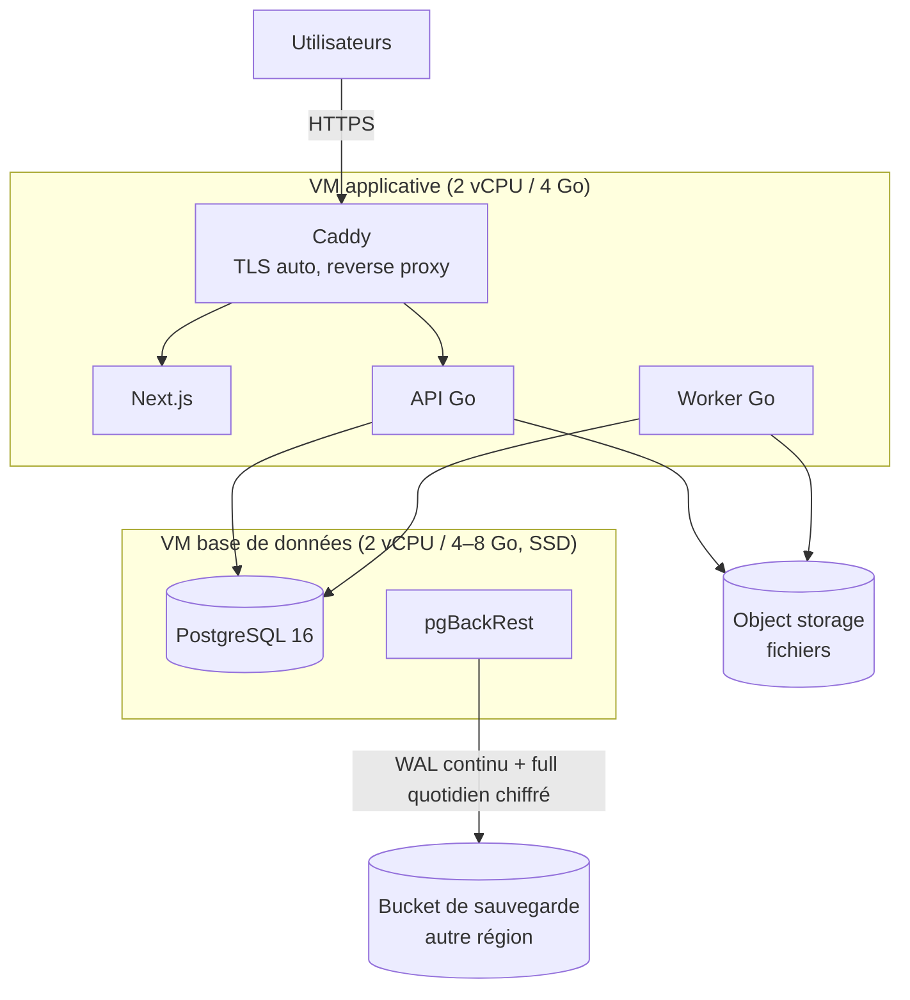

- Base sur une VM séparée dès le départ (ou PostgreSQL managé si disponible chez l'hébergeur retenu) : on peut redimensionner l'applicatif sans toucher aux données.
- Coût indicatif : quelques dizaines d'euros par mois, compatible avec le budget de lancement du cahier.

### 13.3 Phase 2 — Croissance (~100 à 1 000 entreprises)

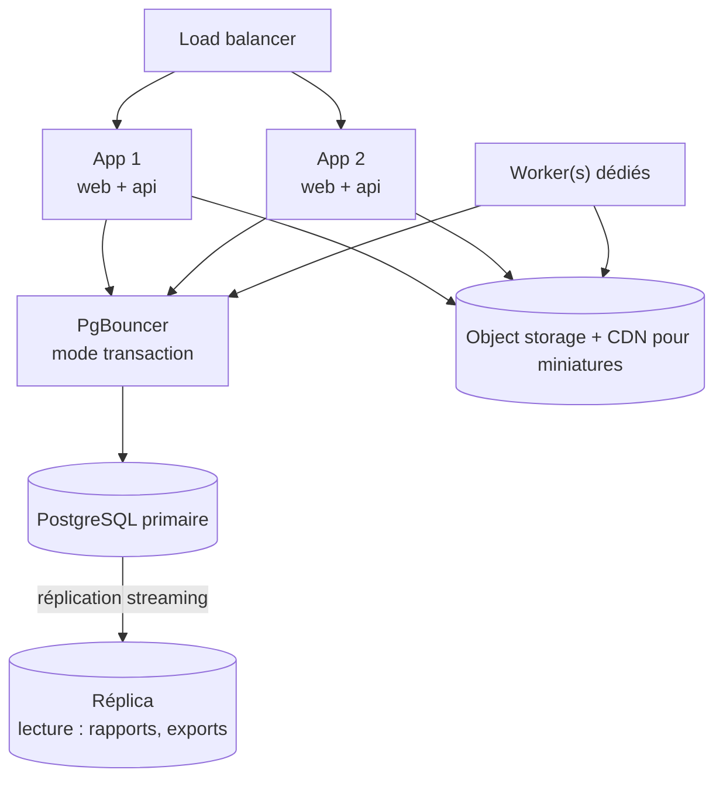

- Le binaire est **sans état** (sessions en base) : on ajoute des instances derrière le load balancer sans changement de code.
- Les exports et rapports consolidés lisent sur le réplica.
- Ajout éventuel de Redis uniquement pour le rate limiting distribué et un cache court, si les mesures le justifient.

### 13.4 Phase 3 — Au-delà (multi-pays, > 1 000 entreprises)

Options, à n'activer que sur signal mesuré : orchestration Kubernetes (déploiements multi-services, autoscaling des workers), extraction du module `reporting` ou `files` en service séparé, partitionnement de `expenses` par `organization_id` (hash), puis distribution horizontale par tenant (Citus) si une seule base primaire ne suffit plus. Le modèle y est déjà préparé : **toutes les clés incluent `organization_id`**, qui est la clé de distribution naturelle.

### 13.5 Hébergement et localisation des données

| Option | Avantages | Points de vigilance |
|---|---|---|
| Cloud / datacenter **au Sénégal** | Proximité des données et des utilisateurs, conformité simplifiée | Offre d'object storage et de PostgreSQL managé à vérifier ; tarifs. |
| Cloud **européen** (région Paris / Amsterdam) | Offre mature (VM, S3, PostgreSQL managé), prix bas, ~80–120 ms de latence depuis Dakar | Transfert hors du Sénégal : formalités auprès de la CDP à vérifier. |
| Hyperscaler (AWS, GCP, Azure) | Services managés complets | Coût et dépendance supérieurs au besoin du MVP ; mêmes questions de transfert. |

**Recommandation** : rester **portable** (conteneurs, S3 standard, PostgreSQL standard, aucune API propriétaire) pour pouvoir changer d'hébergeur sans réécriture ; arrêter le choix après la vérification juridique (décision ouverte n° 6 du cahier).

### 13.6 Sauvegardes et reprise

- **pgBackRest** : sauvegarde complète quotidienne + archivage WAL continu → restauration à la minute près (PITR), chiffrée, dans un bucket d'une autre région.
- Object storage : versionnage du bucket + règle de cycle de vie.
- **Test de restauration mensuel automatisé** sur une VM éphémère (exigence « sauvegarde et restauration testées avant les pilotes »).

### 13.7 CI/CD (GitHub Actions)

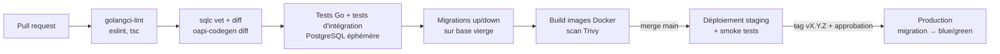

- Migrations **rétrocompatibles** (expand → migrate → contract) pour déployer sans coupure.
- Secrets dans les secrets GitHub / un gestionnaire de secrets ; jamais dans le dépôt.

### 13.8 Observabilité

| Signal | Outil | Exemples |
|---|---|---|
| Erreurs | Sentry (Go + Next.js) | Exceptions, dérive des agrégats, échecs de sync. |
| Logs | `slog` JSON → Loki | `request_id`, `org_id`, `user_id`, route, durée (jamais de secrets). |
| Métriques | Prometheus / Grafana | Latence P95 par route, taux d'erreur, profondeur des files River, connexions PostgreSQL, taille des buckets. |
| Traces | OpenTelemetry | Requête HTTP → requêtes SQL → appels S3. |
| Produit | Événements internes | Activation, temps de saisie d'une dépense, part des saisies offline (KPI du cahier). |

---

## 14. Trajectoire de scalabilité

| Palier | Signal déclencheur | Action |
|---|---|---|
| 1 | P95 > 200 ms sur une route | `EXPLAIN ANALYZE`, index ciblé ; `pg_stat_statements` activé dès le jour 1. |
| 2 | CPU API > 60 % soutenu | 2e instance applicative derrière le load balancer (binaire sans état). |
| 3 | > 200 connexions PostgreSQL | PgBouncer en mode transaction (`SET LOCAL` reste compatible). |
| 4 | Exports/rapports ralentissent les écritures | Réplica en lecture pour `reporting`. |
| 5 | Table d'audit > 50 Go | Détachement et archivage des partitions anciennes vers l'object storage. |
| 6 | `expenses` > 100 M lignes | Partitionnement par hash de `organization_id`. |
| 7 | Une base primaire ne suffit plus | Distribution par tenant (Citus) ou découpage par pays. |
| 8 | Équipes multiples sur un module | Extraction du module en service (frontières déjà en place). |

Les paliers 5 à 8 ne sont **probablement pas nécessaires avant plusieurs milliers d'entreprises clientes** ; ils sont listés pour montrer que le modèle ne bloque aucune de ces évolutions.

---

## 15. Stratégie de tests

| Niveau | Contenu | Outil |
|---|---|---|
| Unitaires | Matrice de permissions (rôle × action), machine à états des dépenses, calcul des deltas financiers, détection de doublons | `go test`, tests par table |
| Intégration base | Chaque requête sqlc sur un vrai PostgreSQL ; triggers (immutabilité, append-only, transitions) ; **tests d'isolation multi-tenant** (2 entreprises, tous les rôles) | `testcontainers-go` |
| Propriétés | Après N opérations aléatoires (soumission, approbation, paiements, annulations), les agrégats = recalcul depuis les sources | `rapid` (property-based testing) |
| API | Contrat OpenAPI, codes d'erreur, idempotence (rejeu d'une même clé), conflits 409 | Tests HTTP Go |
| Front | Parcours critiques (dépense offline → sync, validation, rapport) | Playwright, profils réseau « 3G lente » et « hors ligne » |
| Charge | Tableau de bord et file de validation avec 1 000 entreprises simulées | k6 |
| Sécurité | Scan des dépendances et des images, en-têtes HTTP, tentative d'accès inter-tenant automatisée | Trivy, ZAP baseline |

Les 8 scénarios de recette du cahier (§7.3) deviennent des tests d'intégration nommés `TestRecette01_AccesInterEntrepriseRefuse`, etc.

---

## 16. Risques et décisions encore ouvertes

### 16.1 Risques techniques

| Risque | Mesure |
|---|---|
| Dérive des agrégats (bug dans un delta) | Réconciliation nocturne + test de propriétés + alerte Sentry. |
| Conflits offline mal compris par les utilisateurs | Hors ligne limité aux brouillons ; écran de résolution simple ; mesure du taux de conflits. |
| Croissance rapide du stockage photos | Compression client, miniatures, politique de conservation, bucket sans frais de sortie élevés. |
| RLS mal configurée sur une nouvelle table | Test CI qui échoue si une table possède `organization_id` sans politique RLS. |
| Contrainte « 1 utilisateur = 1 entreprise » trop stricte (sous-traitant, expert-comptable externe) | Évolution prévue : ajout d'une table `memberships` et migration de `users.role` vers elle, sans changer les autres tables (elles référencent déjà `(organization_id, user_id)`). |
| Dépendance à un fournisseur de paiement d'abonnement | Abstraction `billing.Provider` ; paiement manuel (virement / espèces) possible au début. |

### 16.2 Décisions à confirmer

1. **Hébergeur et localisation des données** (après avis juridique sur la loi 2008-12 / CDP).
2. **Seuil de validation par défaut** et catégories initiales (à caler avec les entreprises pilotes).
3. **Plusieurs devises par chantier ?** Le modèle porte une devise par entreprise et par dépense ; le multi-devises demanderait des taux de conversion explicites.
4. **Prestataire d'email et de SMS** (invitations par SMS visibles dans les maquettes).
5. **Prestataire de paiement des abonnements** (Wave Business, Orange Money ou agrégateur) et fréquence de facturation.
6. **Durée de conservation des justificatifs** par défaut (10 ans proposé, à valider avec un comptable).
7. **Notifications WhatsApp** (marquées « Bientôt » dans les maquettes) : opt-in, modèles de messages et coût à valider avant d'activer le canal.

---

*Fin du document — ChantierFlow, architecture technique et modèle de données v1.0.*
